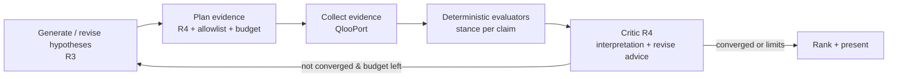

# Tessaloom — Agent Workflow and Execution Behavior

> **Status:** v1.2 · 2026-10-21 (V1: §8.2 test kinds updated from live observations, ADR-019; earlier: cost caps per ADR-018)
> **Scope:** The orchestration engine, its six logical roles, the run state machine, budgets, recovery, validation, observability, the Collision Engine algorithm, the Creative Hypothesis Loop, and the Counterfactual Experimentation Engine.
> **Related:** [ARCHITECTURE.md](ARCHITECTURE.md) · [API_CONTRACTS.md](API_CONTRACTS.md) · [DATABASE_SCHEMA.md](DATABASE_SCHEMA.md)

The type sketches below are **specifications**, not production code. Implementations must live in `packages/core` and `packages/agent` as Zod schemas.

---

## 1. Design principles

1. **Controlled state machine, not free-form autonomy.** The orchestrator owns control flow. The LLM fills in typed decisions within one state, and never chooses arbitrary next states or calls Qloo directly.
2. **Evidence first.** A hypothesis can only reach `SUPPORTED`, `PARTIALLY_SUPPORTED`, or `CONTRADICTED` through evidence records that point at real Qloo tool invocations. The stance on each claim is decided by **deterministic evaluators**. The LLM critic can add interpretation and can downgrade confidence, but it can never upgrade a stance.
3. **Bounded execution.** Every run has hard limits on iterations, Qloo calls, LLM calls, tokens, estimated cost, and wall-clock time. Hitting a limit is a normal, explained outcome (`COMPLETED_WITH_LIMITS`), not a crash.
4. **One step, one commit.** Each state handler runs, then commits all of its outputs atomically. A run can be resumed, retried, or cancelled at any step boundary.
5. **Explain, don't expose.** The Activity Monitor shows concise decision summaries, tool calls, validation outcomes, and budget use. It **never** shows private chain-of-thought. LLM thinking content is not requested for display (`display` omitted) and not stored.
6. **One engine, six roles.** The six roles are role-specific prompt contracts and handlers inside one orchestrator. They do not need six model services or a multi-agent framework.

---

## 2. Logical roles

| ID | Role | Purpose | Uses LLM | Uses Qloo | Output schema |
|---|---|---|---|---|---|
| R1 | **Intent Analysis** | Turn the free-form brief into a structured `IntentFrame`: interests, domains, venue context, constraints, goals, and ambiguities | Yes (`effort: low`) | No | `IntentFrame` |
| R2 | **Cultural Discovery** | Resolve interests into Qloo entities and tags (with disambiguation), then expand cross-domain neighborhoods | Small: ranks candidates when there are several (`effort: low`) | Yes | `ResolutionSet`, `DiscoveryMap` |
| R3 | **Hypothesis Generation** | Weave collision hypotheses from the Collision Engine candidate pool. Each hypothesis has testable claims. | Yes (`effort: high`) | No (proposes queries) | `HypothesisBatch` |
| R4 | **Evidence Criticism & Validation** | Plan evidence queries, run deterministic evaluators, critique the results, and decide whether to revise or stop | Yes for planning and critique (`effort: high`) | Yes (executed by the orchestrator) | `EvidencePlan`, `CritiqueReport` |
| R5 | **Counterfactual Experimentation** | Interpret a variable delta, compute the dirty query set, re-execute, and explain the differences grounded in the computed metrics | Yes for explanation (`effort: medium`) | Yes (only the dirty queries) | `CounterfactualPlan`, `ComparisonNarrative` |
| R6 | **Experience Composition** | Turn selected hypotheses into an experience blueprint. Every section references evidence or is labeled speculative. | Yes (`effort: medium`) | Optional (targeted gap fills such as `wherePopular`) | `BlueprintDraft` |

The effort levels are starting values for the default provider. They are tuned per role by measurement and recorded in `agent_runs.config_snapshot`.

---

## 3. Run kinds

| Run kind | Started by | States used | Ends with |
|---|---|---|---|
| `EXPLORATION` | `POST /projects/:id/experiments` | Intent → resolution → discovery → hypothesis loop | `AWAITING_HYPOTHESIS_SELECTION`, then `COMPLETED` once the user selects (or skips) |
| `COUNTERFACTUAL` | `POST /experiments/:id/branches` | Counterfactual planning → evidence (delta only) → critique → comparison | `COMPLETED` with an `experiment_comparisons` row |
| `COMPOSITION` | `POST /experiments/:id/blueprints` | Compose → validate blueprint | `COMPLETED` with a `blueprint_revisions` row |
| `REVALIDATION` | `POST /experiments/:id/revalidate` | Re-execute the stored evidence plan **live** (no LLM generation) → re-evaluate → compare with the original | `COMPLETED` with a comparison |

---

## 4. Run states

```ts
// packages/core/src/agent/run-state.ts (specification)
export const RunState = z.enum([
  "QUEUED",
  "ANALYZING_INTENT",               // R1
  "AWAITING_BRIEF_CONFIRMATION",    // human gate H1
  "RESOLVING_ENTITIES",             // R2 (search / find tags / describe)
  "AWAITING_ENTITY_CONFIRMATION",   // human gate H2 (only if ambiguous)
  "DISCOVERING",                    // R2 (cross-domain expansion)
  "BUILDING_COLLISION_POOL",        // deterministic Collision Engine stage
  "GENERATING_HYPOTHESES",          // R3
  "PLANNING_EVIDENCE",              // R4 (plan) + orchestrator validation
  "COLLECTING_EVIDENCE",            // orchestrator executes Qloo queries
  "EVALUATING_EVIDENCE",            // deterministic evaluators + R4 critique
  "REVISING_HYPOTHESES",            // R3 revision using critique
  "AWAITING_HYPOTHESIS_SELECTION",  // human gate H3
  "PLANNING_COUNTERFACTUAL",        // R5 (delta → dirty set)
  "AWAITING_COUNTERFACTUAL_CONFIRMATION", // human gate H4 (cost preview)
  "COMPARING",                      // deterministic metrics + R5 narrative
  "COMPOSING_BLUEPRINT",            // R6
  "VALIDATING_BLUEPRINT",           // traceability validator
  // terminal
  "COMPLETED",
  "COMPLETED_WITH_LIMITS",          // a budget limit ended the loop; results are partial but valid
  "FAILED",
  "CANCELLED",
]);
```

`AWAITING_*` states are **paused** states. No job is queued while a run is paused. A paused run expires to `CANCELLED` (reason `EXPIRED`) after 24 hours, which is configurable.

---

## 5. State machine

### 5.1 Diagram

```mermaid
stateDiagram-v2
  [*] --> QUEUED
  QUEUED --> ANALYZING_INTENT: EXPLORATION
  QUEUED --> PLANNING_COUNTERFACTUAL: COUNTERFACTUAL
  QUEUED --> COLLECTING_EVIDENCE: REVALIDATION
  QUEUED --> COMPOSING_BLUEPRINT: COMPOSITION

  ANALYZING_INTENT --> AWAITING_BRIEF_CONFIRMATION
  AWAITING_BRIEF_CONFIRMATION --> RESOLVING_ENTITIES: confirmed
  AWAITING_BRIEF_CONFIRMATION --> ANALYZING_INTENT: brief edited

  RESOLVING_ENTITIES --> AWAITING_ENTITY_CONFIRMATION: ambiguous / needs_input
  RESOLVING_ENTITIES --> DISCOVERING: all resolved
  AWAITING_ENTITY_CONFIRMATION --> DISCOVERING: confirmed
  AWAITING_ENTITY_CONFIRMATION --> RESOLVING_ENTITIES: user refined terms

  DISCOVERING --> BUILDING_COLLISION_POOL
  BUILDING_COLLISION_POOL --> GENERATING_HYPOTHESES
  GENERATING_HYPOTHESES --> PLANNING_EVIDENCE
  PLANNING_EVIDENCE --> COLLECTING_EVIDENCE
  COLLECTING_EVIDENCE --> EVALUATING_EVIDENCE
  EVALUATING_EVIDENCE --> REVISING_HYPOTHESES: revise (iteration < max)
  REVISING_HYPOTHESES --> PLANNING_EVIDENCE
  EVALUATING_EVIDENCE --> AWAITING_HYPOTHESIS_SELECTION: EXPLORATION terminates loop
  EVALUATING_EVIDENCE --> COMPARING: COUNTERFACTUAL / REVALIDATION
  AWAITING_HYPOTHESIS_SELECTION --> COMPLETED: selection recorded

  PLANNING_COUNTERFACTUAL --> AWAITING_COUNTERFACTUAL_CONFIRMATION: cost above auto-approve threshold
  PLANNING_COUNTERFACTUAL --> COLLECTING_EVIDENCE: auto-approved
  PLANNING_COUNTERFACTUAL --> COMPARING: no dirty queries (rescore only)
  AWAITING_COUNTERFACTUAL_CONFIRMATION --> COLLECTING_EVIDENCE: confirmed
  COMPARING --> COMPLETED

  COMPOSING_BLUEPRINT --> VALIDATING_BLUEPRINT
  VALIDATING_BLUEPRINT --> COMPOSING_BLUEPRINT: repairable violations (max 1 repair)
  VALIDATING_BLUEPRINT --> COMPLETED

  note right of COMPLETED_WITH_LIMITS: reachable from any non-terminal state when a budget is exhausted
  note right of FAILED: reachable from any non-terminal state on an unrecoverable error
  note right of CANCELLED: reachable from any non-terminal state on user cancel or expiry
```

### 5.2 Transition rules

Transitions are defined declaratively in `packages/agent/src/machine.ts` as a table of `{ from, event, to, guard }` entries. The orchestrator rejects any transition that is not in the table. This is covered by the tests in [TEST_PLAN.md §4](TEST_PLAN.md#4-agent-state-transition-tests).

| From | Event | To | Guard |
|---|---|---|---|
| `QUEUED` | `START` | first state for the run kind | run kind is known |
| `ANALYZING_INTENT` | `INTENT_READY` | `AWAITING_BRIEF_CONFIRMATION` | `IntentFrame` is valid |
| `AWAITING_BRIEF_CONFIRMATION` | `USER_CONFIRMED_BRIEF` | `RESOLVING_ENTITIES` | confirmation references the current brief version |
| `AWAITING_BRIEF_CONFIRMATION` | `USER_EDITED_BRIEF` | `ANALYZING_INTENT` | a new brief version exists |
| `RESOLVING_ENTITIES` | `RESOLUTION_AMBIGUOUS` | `AWAITING_ENTITY_CONFIRMATION` | ≥ 1 interest has status `AMBIGUOUS` or `UNRESOLVED` |
| `RESOLVING_ENTITIES` | `RESOLUTION_COMPLETE` | `DISCOVERING` | every interest is `RESOLVED` or explicitly `EXCLUDED` |
| `AWAITING_ENTITY_CONFIRMATION` | `USER_CONFIRMED_ENTITIES` | `DISCOVERING` | ≥ 2 seeds in ≥ 2 distinct domains |
| `AWAITING_ENTITY_CONFIRMATION` | `USER_REFINED_TERMS` | `RESOLVING_ENTITIES` | — |
| `DISCOVERING` | `DISCOVERY_DONE` | `BUILDING_COLLISION_POOL` | ≥ 1 discovery query returned `ok` or `partial` |
| `DISCOVERING` | `DISCOVERY_EMPTY` | `FAILED` | every discovery query returned `empty` or `error` (reason `NO_DISCOVERY_DATA`) |
| `BUILDING_COLLISION_POOL` | `POOL_READY` | `GENERATING_HYPOTHESES` | pool size ≥ 3 |
| `GENERATING_HYPOTHESES` | `HYPOTHESES_READY` | `PLANNING_EVIDENCE` | ≥ 1 valid hypothesis after validation |
| `PLANNING_EVIDENCE` | `PLAN_READY` | `COLLECTING_EVIDENCE` | plan is within the remaining budget |
| `COLLECTING_EVIDENCE` | `COLLECTION_DONE` | `EVALUATING_EVIDENCE` | every planned query reached a final outcome |
| `EVALUATING_EVIDENCE` | `REVISE` | `REVISING_HYPOTHESES` | the termination criteria (§12) are **not** met and `iteration < maxIterations` |
| `EVALUATING_EVIDENCE` | `CONVERGED` | `AWAITING_HYPOTHESIS_SELECTION` or `COMPARING` | the termination criteria are met |
| `REVISING_HYPOTHESES` | `REVISION_READY` | `PLANNING_EVIDENCE` | iteration incremented |
| `PLANNING_COUNTERFACTUAL` | `DELTA_NEEDS_CONFIRMATION` | `AWAITING_COUNTERFACTUAL_CONFIRMATION` | estimated Qloo calls > `autoApproveQlooCalls` (default 6) |
| `PLANNING_COUNTERFACTUAL` | `DELTA_RESCORE_ONLY` | `COMPARING` | the dirty query set is empty |
| `COMPARING` | `COMPARISON_READY` | `COMPLETED` | the comparison row is committed |
| `VALIDATING_BLUEPRINT` | `BLUEPRINT_INVALID` | `COMPOSING_BLUEPRINT` | `repairAttempts < 1` |
| *any non-terminal* | `BUDGET_EXHAUSTED` | `COMPLETED_WITH_LIMITS` | the outputs committed so far are self-consistent |
| *any non-terminal* | `FATAL_ERROR` | `FAILED` | — |
| *any non-terminal* | `CANCEL` | `CANCELLED` | — |

---

## 6. State persistence and step execution

### 6.1 Persisted run record

```ts
// Persisted in agent_runs (see DATABASE_SCHEMA.md §4.9)
type AgentRun = {
  id: UUIDv7;
  experimentId: UUIDv7;
  kind: "EXPLORATION" | "COUNTERFACTUAL" | "COMPOSITION" | "REVALIDATION";
  state: RunState;
  stateVersion: number;        // optimistic concurrency; incremented on every commit
  iteration: number;           // hypothesis loop iteration (0-based)
  budget: RunBudget;           // limits (immutable after start)
  usage: RunUsage;             // counters (updated per commit)
  configSnapshot: RunConfig;   // model id, effort per role, prompt versions,
                               // adapter version, harness version, ruleset version
  pendingConfirmation: ConfirmationRequest | null;
  cancelRequestedAt: Timestamp | null;
  terminalReason: string | null;
  traceId: string;
};
```

### 6.2 Step algorithm (worker)

```
handleRunStep(job { runId, expectedStateVersion }):
  run = load(runId)
  if run.stateVersion != expectedStateVersion: ack and exit       // stale or duplicate job
  if run.state is terminal or AWAITING_*: ack and exit
  if run.cancelRequestedAt: commitTransition(CANCEL); exit
  if budgetExhausted(run): commitTransition(BUDGET_EXHAUSTED); exit
  ctx = buildContext(run)                    // read-only snapshot of inputs
  result = handlers[run.state](ctx)          // may call QlooPort / LlmPort; no DB writes
  tx:
     assert run.stateVersion == expectedStateVersion (SELECT ... FOR UPDATE)
     persist(result.records)                 // snapshots, invocations, entities, hypotheses, evidence
     append run_events (decision summary, tool events, validation events)
     apply transition(result.event)          // validated against the transition table
     update usage, stateVersion += 1
     if next state is runnable: enqueue run.step(runId, stateVersion + 1)
```

- **Idempotency.** The pg-boss singleton key is `run:${runId}:${stateVersion}`. External calls made before a failed commit are recorded on retry as new invocation rows with `attempt + 1`. Qloo calls made during a failed attempt are counted in the quota counter even though no evidence was committed. Quota counters are updated in a separate small transaction immediately after each call.
- **Heartbeat.** The worker updates `worker_heartbeats` every 10 s. The web readiness check and the "agent offline" UI banner depend on it.

---

## 7. Execution budgets and iteration limits

Defaults live in `packages/core/src/agent/budget.ts`. They are overridable per environment, and final values must be set once the event quota is known (**PENDING**).

| Limit | EXPLORATION | COUNTERFACTUAL | COMPOSITION | REVALIDATION |
|---|---|---|---|---|
| `maxIterations` (hypothesis loop) | 3 | 1 | — | 1 |
| `maxHypotheses` generated per iteration | 6 | — (held fixed by default) | — | — |
| `maxClaimsPerHypothesis` | 3 | 3 | — | 3 |
| `maxQlooCalls` | 40 | 15 | 4 | 40 |
| `maxLlmCalls` | 14 | 4 | 3 | 1 |
| `maxLlmOutputTokens` (sum) | 60 000 | 15 000 | 20 000 | 4 000 |
| `maxEstimatedCostUsd` (LLM) | 2.00 | 0.40 | 0.70 | 0.15 |
| `wallClockSeconds` | 420 | 180 | 180 | 240 |
| Per-Qloo-call timeout | 30 s (**PENDING LIVE VALIDATION** of typical latency) | | | |
| Per-LLM-call timeout | 120 s (streaming) | | | |

The cost caps follow the pre-measurement cost model in [DECISIONS.md ADR-018](DECISIONS.md#adr-018-llm-model-verification-fallback-model-cost-model-and-credentials). On `claude-opus-5-5`, a typical EXPLORATION costs about $1.09 and the 3-iteration ceiling about $1.65. Re-baseline after M6 from measured `llm_invocations`.

Global guards (in `usage_counters`):

- `GLOBAL_DAILY_QLOO_CALLS`: set to about 70% of the published event quota. Until the quota is known, the default is 300 per day.
- `GLOBAL_DAILY_LLM_USD`: default 15.
- `WORKSPACE_DAILY_RUNS`: default 10 live runs per anonymous workspace per day.

When a guard trips, new live runs are refused with `QUOTA_GUARD_ACTIVE`. Sample projects in REPLAY mode keep working.

**Budget pre-check.** Before every external call the orchestrator computes `remaining = budget − usage`. If the planned call would exceed any limit, it emits `BUDGET_EXHAUSTED` with the name of the limit that was hit. Evidence plans are trimmed *before* execution: claims are prioritized by hypothesis composite score, untested claims are kept, and the trimmed claims are marked `UNTESTED_BUDGET`.

---

## 8. Tool selection

### 8.1 Allowlist per state

The LLM proposes **typed evidence queries**, not raw tool calls. The orchestrator maps each proposal to a `QlooPort` method and checks it against this allowlist:

| State | Allowed `QlooPort` methods |
|---|---|
| `RESOLVING_ENTITIES` | `searchEntities`, `findTags`, `describeEntity` |
| `DISCOVERING` | `recommend`, `entityTags`, `findTags` |
| `COLLECTING_EVIDENCE` | `recommend`, `rank`, `compareAudiences`, `entityTags`, `wherePopular`, `trends`, `audienceDemographics` |
| `COMPOSING_BLUEPRINT` | `wherePopular`, `rank` (gap fills only, max 4) |
| All other states | none |

### 8.2 Claim test kinds

Each hypothesis claim declares a `testKind`. The test kind determines which tool runs and which deterministic evaluator grades the result.

| `testKind` | Question it answers | `QlooPort` method | Deterministic evaluator (APP_DERIVED) | Qloo capability status |
|---|---|---|---|---|
| `CROSS_DOMAIN_AFFINITY` | Do audiences with affinity for seed A also show affinity for entities in domain T (optionally entity B or tag G)? | `recommend(signals=[A…], targetType=T, signal_tags?/include_tags?)` | Read the category from `subtype`. SUPPORTS if B ranks in the top K **and** its affinity is ≥ the result-set median plus `δ`, or if ≥ `m` of the top K carry tag G (tags via `include_tags` or per-result `entityTags`). CONTRADICTS if there are ≥ K results and none match. INSUFFICIENT on flat affinity spread (< `σ_min`) or < K results. Prefer ≥ 2 signals. | ✅ **V1 confirmed:** `signals`, `signal_tags` (+ operator), `include_tags`/`exclude_tags`, `affinity`, `explainability` (LC-5a/5b/16). Single-seed face validity is limited (ADR-019). |
| `SHORTLIST_FIT` | Which of these candidate elements best fits the audience of seeds S? | `rank(options[≤10], optionType, signals)` | Ordered by affinity. SUPPORTS if the claimed element ranks in the top ⌈n/3⌉, CONTRADICTS if it ranks in the bottom ⌈n/3⌉. Scores are not compared across calls. | ✅ **V1 confirmed:** results ordered by affinity, consistent with `recommend` affinities (LC-6). |
| `AUDIENCE_BRIDGE` | Do the audiences of A and B overlap enough to share one experience? | `compareAudiences(groupA, groupB, targetType?)` | **Redefined (V1):** SUPPORTS if shared `tags[]` or `matchEntities[]` is non-empty, or if the tag subtypes of `a[]` and `b[]` overlap by ≥ `ω`. INSUFFICIENT when all overlap is empty (absence in the top lists is not proof of disjoint audiences). Never CONTRADICTS. | 🟨 **V1 partial:** returns `{ tags[], a[], b[], matchEntities[] }` tag profiles with no similarity score; `limit` not honored (LC-7). |
| `TAG_RESONANCE` | Does entity X carry the cultural theme the hypothesis relies on? | `entityTags(X)` | SUPPORTS if the theme's resolved tag ID is present **and** its tag type is in the observed allowlist (`genre, subgenre, keyword, plot, motif, character, style`); NEUTRAL otherwise. `endorsement`/`book_format` tags are ignored. | ✅ **V1 confirmed:** `{ id, name, type, popularity, affinity }`; noisy tag types observed (LC-4). |
| `LOCATION_FIT` | **Redefined (V1):** within the venue's locality, how strongly does the anchor entity's audience concentrate (and is the venue near a high-affinity cell)? | `wherePopular(entity, within=locality)` | SUPPORTS if the top cell's `affinity` ≥ `α` and, when venue coordinates are known, a top-3 cell lies within `r` km. NEUTRAL otherwise. It does not compare cities. | 🟨 **V1 partial:** intra-city geohash cells `{ latitude, longitude, geohash, affinity, affinity_rank, popularity }`, with no area names (LC-8). |
| `MOMENTUM` | Is an element rising, making the concept timely? | `trends(entityType, entities[1..5], dateRange)` | SUPPORTS if `population_rank_velocity` > 0 and `velocity_fold_change` ≥ `φ` over the latest points; NEUTRAL if flat. **Empty `points` → INSUFFICIENT; `book` → UNTESTABLE.** | 🟨 **V1 partial:** `movie` returned 10 points with the documented fields; `book` → `QLOO_CONTRACT`; a 2026 `artist` window returned 0 points (LC-9…9d). |
| `AUDIENCE_PROFILE` | What aggregate audience characteristics does the combined concept attract? (Planning context only) | `audienceDemographics(entity)` | Descriptive only: NEUTRAL stance with aggregate facts. Values are **relative indices in [−1, 1]**, never shown as shares of people. **Never** used to exclude or target individuals. | ✅ **V1 confirmed:** `age` (6 bands) and `gender` indices (LC-10). |

`K`, `m`, `δ`, `σ_min`, `ω`, `α`, `r`, and `φ` are versioned in `EVALUATION_RULESET_VERSION`. Starting defaults: `K = 20` (the harness maximum per call), `m = 3`. The new V1 parameters start as placeholders and are calibrated in M6 from live observations; the calibration is recorded in DECISIONS.md. Every evidence record stores the ruleset version that graded it. The test-kind semantics above follow [ADR-019](DECISIONS.md#adr-019-v1-observed-qloo-contract).

---

## 9. Cancellation

- `POST /api/v1/runs/:id/cancel` sets `cancel_requested_at` and appends a `CANCEL_REQUESTED` event. The request is idempotent.
- The worker checks the flag before each external call and before commit. In-flight Qloo calls cannot be interrupted at the API; the MCP request is abandoned through an `AbortSignal` and its result is discarded. In-flight LLM streams are aborted.
- Records committed before cancellation are kept. The run moves to `CANCELLED`, and any partial hypotheses remain visible with the label "Run cancelled — evidence incomplete".
- A paused (`AWAITING_*`) run is cancelled immediately in the web transaction.

---

## 10. Retry policies and error recovery

| Failure | Detection | Policy | Final outcome if retries are exhausted |
|---|---|---|---|
| Qloo envelope `status: error`, `retryable: true` | Adapter | Up to 2 retries, exponential backoff `1s, 3s` ± 30% jitter. Retries count against the budget. | Claim → `INCONCLUSIVE` with `errorCode`. The run continues. |
| Qloo `status: error`, `retryable: false` (for example `QLOO_AUTH`) | Adapter | No retry | `QLOO_AUTH` → run `FAILED` (`QLOO_UNAVAILABLE`), an admin alert in the logs, and a UI banner. Other codes → claim `INCONCLUSIVE`. |
| Rate limit (error code or HTTP 429 surfaced by the harness; exact code is **PENDING**) | Adapter | Respect `retry-after` if present; otherwise back off 5 s and 15 s. Global limiter tokens drained. | Claim → `INCONCLUSIVE`. If ≥ 50% of the planned queries fail this way → `COMPLETED_WITH_LIMITS` (`RATE_LIMITED`). |
| Qloo `needs_input` | Adapter | No retry. During resolution → move to `AWAITING_ENTITY_CONFIRMATION` and show the candidates. During evidence → claim `INCONCLUSIVE` (`AMBIGUOUS_INPUT`). | — |
| Qloo `empty` | Adapter | No retry | Evaluator decides (often INSUFFICIENT) |
| Qloo `partial` / `degraded` | Adapter | No retry. Data is used, with `quality: PARTIAL / DEGRADED` recorded and shown. | — |
| Harness child process crash / stdio closed | Transport | Restart the child (backoff 1, 2, 4 s, max 3 in 60 s), then retry the call once. After that, fall back to `HarnessCliTransport` for the call. | Run `FAILED` (`QLOO_TRANSPORT_DOWN`) |
| Qloo timeout | Transport `AbortSignal` | 1 retry | Claim → `INCONCLUSIVE` (`TIMEOUT`) |
| LLM 429 / 5xx / overloaded / network | SDK (max 2 retries) | SDK retries, then the **whole step is retried on `LLM_FALLBACK_MODEL`** (ADR-018). It is never switched mid-conversation, and the switch is recorded with `fallback_used`. | Step fails; pg-boss retries the job (max 2) → `FAILED` (`LLM_UNAVAILABLE`) |
| Remaining cost budget too small for the primary model | Gateway pre-check | Use `LLM_FALLBACK_MODEL` for the step if its estimate fits | `BUDGET_EXHAUSTED` → `COMPLETED_WITH_LIMITS` |
| LLM `stop_reason: refusal` | Gateway | Server-side fallback (if enabled) handles it once; otherwise no retry | Step outcome `REFUSED` → run `FAILED` with a neutral user message suggesting the brief be rephrased |
| LLM `stop_reason: max_tokens` | Gateway | 1 retry with a 1.5× `max_tokens` cap if within budget | `FAILED` (`LLM_OUTPUT_TRUNCATED`) |
| LLM output fails schema or semantic validation | Gateway / validators | 1 **repair attempt**: the validation errors are sent back as a user message; the conversation is append-only | Step fails. The invalid output is stored for debugging (`llm_invocations.validation_status = INVALID`). Run `FAILED` (`LLM_INVALID_OUTPUT`). |
| DB serialization or stale `stateVersion` | Commit | Abort the commit; drop the stale job | The latest run state wins |
| Worker crash mid-step | pg-boss visibility timeout | Job retried (max 2) | `FAILED` (`STEP_RETRIES_EXHAUSTED`) |

**User-visible recovery actions** are listed in [UI_UX_SPEC.md §6](UI_UX_SPEC.md#6-empty-loading-error-and-recovery-states): *Retry step* (re-enqueues the failed state from the last committed version, only when the failure was transient), *Revise brief*, *Refine entities*, and *Start branch*.

---

## 11. Human confirmation points

| Gate | When | What the user sees | Possible responses |
|---|---|---|---|
| **H1 — Brief confirmation** | After R1 | The `IntentFrame` as editable chips: interests, domains, venue, constraints, goals, plus detected ambiguities | Confirm · Edit brief (creates a new brief version) |
| **H2 — Entity confirmation** | When an interest is ambiguous, unresolved, or returned `needs_input` | Candidate entities and tags with Qloo type, disambiguating details, and **only** the fields Qloo actually returned | Pick a candidate · Refine search text · Exclude the interest |
| **H3 — Hypothesis selection** | End of EXPLORATION | Ranked hypothesis cards with evidence status | Select 1–3 for composition · Branch (what-if) · Finish without selecting |
| **H4 — Counterfactual cost confirmation** | A delta needs more than 6 Qloo calls | The dirty query list, estimated calls, remaining daily quota | Run · Reduce scope · Cancel |
| **Blueprint review** | After COMPOSITION | Draft blueprint with traceability markers | Accept · Edit (creates a user revision) · Recompose section |

Gates H1 and H2 are what make resolution **trustworthy**. The kit's safe-use guide instructs: *"Ask for clarification when an entity or tag choice would materially change a result"* and *"Do not pass an uncertain tag into later requests."* Gate H1 can be set to auto-confirm for sample projects running in replay mode.

---

## 12. Creative Hypothesis Loop and termination



**Hypothesis status** is computed by `core/hypothesis/status.ts` and is APP_DERIVED:

| Status | Rule |
|---|---|
| `SPECULATIVE` | No evidence collected yet (newly generated) |
| `UNDER_INVESTIGATION` | Evidence is planned or partly collected in the current iteration |
| `SUPPORTED` | ≥ 2 claims SUPPORTS, 0 claims CONTRADICTS, and the evidence comes from ≥ 2 distinct tool invocations |
| `PARTIALLY_SUPPORTED` | ≥ 1 SUPPORTS and (≥ 1 CONTRADICTS or ≥ 1 INSUFFICIENT) |
| `CONTRADICTED` | CONTRADICTS on the majority of tested claims and no SUPPORTS |
| `INCONCLUSIVE` | All tested claims are INSUFFICIENT, or tests failed (errors, timeouts) |
| `UNTESTABLE` | No claim maps to an available test kind (for example, it depends on data Qloo does not provide). Shown as creative speculation. |

**The loop terminates when the first of these holds:**

1. **Convergence.** Each of the top `min(3, n)` hypotheses by composite score has a status in {SUPPORTED, PARTIALLY_SUPPORTED, CONTRADICTED, UNTESTABLE}.
2. **Diminishing returns.** The last iteration changed no hypothesis status and added fewer than 2 new SUPPORTS/CONTRADICTS stances.
3. **Iteration limit.** `iteration + 1 ≥ maxIterations`.
4. **Budget.** Any budget limit is reached, which leads to `COMPLETED_WITH_LIMITS`.

**Revision behavior (R3 in `REVISING_HYPOTHESES`).** R3 receives the critique and the per-claim stances. It may:

- (a) **refine** a hypothesis: it keeps its lineage via `revision_of_id`, may change claims, and is re-tested;
- (b) **retire** a contradicted hypothesis, which stays visible as `CONTRADICTED`;
- (c) **spawn** at most 2 new hypotheses from unused pool candidates.

R3 may **not** delete evidence or alter any claim's past stance.

---

## 13. Evidence validation and hallucination prevention

### 13.1 Evidence record rules

- An evidence record with `provenance_class = QLOO_SOURCED` must reference a `tool_invocation_id` whose `data_origin ∈ {LIVE, CACHE, REPLAY}`. This is enforced by a DB `CHECK` constraint plus a validator.
- An evidence record with `data_origin = FIXTURE` gets `provenance_class = DEVELOPMENT_FIXTURE`. This cannot be displayed in a production build: the API layer refuses to serialize such records when `APP_ENV=production`.
- Each `facts[]` entry stores `{ statement, jsonPointer, value }`. `jsonPointer` points into the stored raw snapshot. The validator re-reads the snapshot and confirms the value at that pointer equals `value`.

### 13.2 Output validators (run on every LLM output before commit)

| Validator | Applies to | Rule | On violation |
|---|---|---|---|
| `SchemaValidator` | All roles | Output parses against the role's Zod schema | Repair attempt |
| `EntityGroundingValidator` | R3, R5, R6 | Every `entityRef` exists in `cultural_entities` for this experiment. Free-text names that are not grounded must be inside `creativeElements[]`, labeled `CREATIVE_SPECULATION`. | Repair attempt; then the ungrounded element is dropped and logged |
| `CitationValidator` | R4 critique, R5 narrative, R6 blueprint | Every sentence-level claim attributed to Qloo cites ≥ 1 `evidenceId` from this experiment. Citations to unknown IDs are rejected. | Repair attempt |
| `NumericFidelityValidator` | R5 narrative, R6 blueprint | Every number in prose must equal a value in the provided metrics or evidence facts (tolerance 0). Narrative numbers are written as `{{metric:ID}}` placeholders and rendered by the app. | Repair attempt; then the narrative is replaced by the deterministic template summary |
| `StanceIntegrityValidator` | R4 critique | The critic cannot change a deterministic stance. It can only add `confidenceNote` or set `downgrade: true` with a reason. | Reject the field |
| `ProvenanceLabelValidator` | All persisted display text | Each block carries exactly one provenance class | Reject |
| `SafeUseValidator` | All outputs | No inference about individuals, sensitive traits, or high-impact eligibility, following the kit's SAFE_USE.md. Affinity must not be phrased as causation or as an individual probability. | Repair attempt with a policy reminder |

### 13.3 Additional measures

- **Ground before generating.** R3 receives only the collision pool: entity IDs, names, types, tags, and bridge facts. Its prompt instructs it to reference elements **only by ID**.
- **Retrieval, not recall.** Prompts forbid stating cultural facts that are not in the provided evidence. Background creative flavor goes into `creativeElements` with a speculation label.
- **Typed numbers.** Scores, counts, and deltas are always computed by `core` code and never generated by the LLM.

---

## 14. Experiment reproducibility

### 14.1 Experiment definition and deterministic key

```ts
type ExperimentDefinition = {
  schemaVersion: 1;
  briefContentHash: string;            // sha256 of the canonical brief version content
  seeds: { qlooId: string; kind: "entity" | "tag"; role: "seed" }[]; // sorted by qlooId
  variables: ExperimentVariables;      // target domains, location, tag constraints, time window,
                                       // audience band, collision tension, constraint set
  scoringWeights: { support: number; novelty: number; feasibility: number };
  budgets: RunBudget;
  versions: {
    evaluationRuleset: string;
    promptSet: string;                 // hash of all prompt template versions used
    qlooAdapter: string;
    harness: string;                   // e.g. "0.1.26"
    llmModel: string;                  // e.g. "claude-opus-5-5"
  };
  parentExperimentKey: string | null;  // for branches
  variableDelta: VariableDelta | null; // for branches
};
experimentKey = sha256Hex(JCS(ExperimentDefinition));   // RFC 8785 canonical JSON
```

The same key means **the same configuration**. It is stored as a unique key per project: `(project_id, experiment_key)`. Starting an identical experiment again returns the existing one, unless the user explicitly asks for a **live re-run**. A live re-run creates a `REVALIDATION` run instead of a duplicate experiment.

### 14.2 Three levels of reproducibility

| Level | Guarantee | Mechanism |
|---|---|---|
| **Replay** (exact) | Bit-identical evidence, stances, scores, and rendered narrative | Stored `qloo_response_snapshots` + stored `llm_invocations.output` are replayed. No external calls. Used for sample projects and the share view. |
| **Re-evaluation** (deterministic) | The same stored data under a changed ruleset or weights gives deterministic new scores | Pure functions in `core`, versioned rulesets |
| **Live revalidation** (empirical) | The same evidence plan executed against live Qloo today. Differences are attributed to data drift. | A `REVALIDATION` run plus an `experiment_comparisons` row (data-drift comparison) |

LLM sampling cannot be fixed on the default model (sampling parameters are not accepted). Reproducibility of generated text is therefore achieved **only** through recorded outputs, and the docs and UI say so plainly.

---

## 15. Counterfactual Experimentation Engine

### 15.1 Variables that can be changed

| Variable | Example | Affects |
|---|---|---|
| `seeds` (add / remove / swap) | Swap "Sun Ra" → "Janelle Monáe" | Every query whose `signals` include the seed |
| `targetDomains` | Add `podcast` | Discovery and cross-domain queries for that domain |
| `tagConstraints` | Require tag "cozy" | Queries with tag filters (**PENDING** harness support) and evaluator tag checks |
| `location` | Lisbon → Porto | `LOCATION_FIT` queries; location-filtered recommends (**PENDING**) |
| `audienceBand` (aggregate age band) | 25–34 → 35–44 | Queries with a `demographic` signal (**PENDING** harness parameter names) |
| `timeWindow` | Last 12 weeks → last 26 weeks | `MOMENTUM` queries |
| `collisionTension` | Harmonious ↔ Unexpected | Collision pool selection (deterministic); hypotheses only if regenerating |
| `scoringWeights` | More weight on feasibility | **Rescore only. No new data.** The UI states this. |
| `constraints` (budget band, capacity, duration) | Capacity 40 → 120 | Feasibility scoring only. **No new data.** |

### 15.2 Dependency-aware recomputation

Each `EvidenceQuery` in the stored evidence plan has a `dependsOn: VariablePath[]` field (for example `["seeds[qloo:abc]", "location"]`) and a canonical `requestHash`. For a `VariableDelta`:

1. **Rebuild** the query plan under the new variables, using the same hypotheses (*hold-fixed mode*, the default).
2. **Diff the plans.** A query is **dirty** if its `requestHash` changed or it is new. A query is **reused** if its hash is unchanged; reused data is relabeled `dataOrigin: CACHE` and links to the original invocation.
3. **Execute only the dirty queries** live, within the budget (gate H4 if more than 6 calls).
4. **Re-run** the deterministic evaluators for every claim, then recompute statuses and scores.
5. **Compare** the parent and branch (§15.3).

**Regenerate mode** is optional and must be chosen explicitly by the user. R3 generates new hypotheses under the changed variables. The comparison then has two parts: *hypothesis set differences* and *evidence differences for shared claims*. Hold-fixed mode is the default because it isolates the effect of the variable, which is the essence of a counterfactual.

**Genuineness guarantee.** The comparison header always reports `dirtyQueries`, `reusedQueries`, `newQlooResults`, and `changedStances`. If `dirtyQueries = 0`, the UI labels the result "Rescored with existing evidence — no new Qloo data was retrieved". The LLM narrative is forbidden from implying new data (`NumericFidelityValidator` plus a template check).

### 15.3 Comparison metrics (APP_DERIVED, `core/metrics/compare.ts`)

| Metric | Definition | Granularity |
|---|---|---|
| `overlapAtK` | Jaccard similarity of the top-K Qloo entity ID sets for the same logical query in the parent and branch | Per query |
| `rbo` | Rank-Biased Overlap (p = 0.9) of the two ranked result lists | Per ranked query |
| `entered` / `exited` | Entities newly appearing in, or disappearing from, the top K | Per query |
| `stanceChanges` | Claims whose stance changed (from → to) | Per claim |
| `statusChanges` | Hypothesis status transitions | Per hypothesis |
| `scoreDeltas` | Support / novelty / feasibility / composite deltas | Per hypothesis |
| `rankShift` | Change in a hypothesis's position in the composite ranking | Per hypothesis |
| `driftIndex` | Mean (1 − overlapAtK) across dirty queries | Per comparison |

The R5 narrative receives these metrics (IDs + values) and must explain the **largest changes, with citations**. All numbers are rendered from placeholders.

---

## 16. Cultural Collision Engine (BUILDING_COLLISION_POOL)

This stage is deterministic except for optional tie-break ranking.

1. **Threads.** For each seed `s` and each target domain `T ≠ domain(s)`, call `recommend(signals=[s], targetType=T)` (in `DISCOVERING`) and keep the top `k = 10` results. These are *threads*.
2. **Bridges.** For each pair of elements `(x, y)` from **different domains** and **different seeds' threads**:
   - `sharedTags(x, y)`: the intersection of tag ID sets, only when tags are available (**PENDING**);
   - `coOccurrence(x, y)`: whether `y` appears in the threads of the seed behind `x`, and vice versa.
   - A pair is a *bridge* if `sharedTags ≥ 1` or `coOccurrence` holds. Bridges carry APP_DERIVED facts with evidence pointers.
3. **Candidate scoring:**
   - `relevance = normalized position-weighted presence in threads` (Qloo-derived ordering);
   - `novelty = 1 − Jaccard(tags(x), tags(y))`, plus a domain-distance bonus when the domains differ by category class (media ↔ place ↔ product). When tags are unavailable, novelty uses domain distance only and is flagged `REDUCED_INPUTS`;
   - `tensionFit = 1 − |novelty − τ|`, where `τ ∈ [0.2, 0.9]` comes from the **Collision Tension** slider (Harmonious → Unexpected).
4. **Selection.** Maximal Marginal Relevance over `0.5·relevance + 0.5·tensionFit` with a diversity penalty, so no two candidates share both elements' domains. This yields a pool of 8–12 candidate collisions, each with 2–3 elements.
5. **Weaving.** R3 receives the pool and produces hypotheses. Each hypothesis states a concept (title, premise, an experience sketch), its **elements by ID**, 1–3 **testable claims** with `testKind`, and optional `creativeElements` labeled speculation.
6. **Ranking.** `composite = w_s·support + w_n·novelty + w_f·feasibility`. Default weights are 0.40 / 0.35 / 0.25 and can be changed by the user (a rescore-only counterfactual). Scores are 0–100, and every displayed score has a breakdown tooltip.

`support` is computed from claim stances: `(Σ SUPPORTS·1 + Σ PARTIAL·0.5 − Σ CONTRADICTS·1) / testedClaims`, mapped to 0–100. `feasibility` is rule-based against the brief's constraints (capacity, budget band, duration, venue type, location evidence), with R6/R4 notes attached as interpretation.

---

## 17. Observability

### 17.1 Run event types (`run_events.type`)

`RUN_STARTED`, `STATE_ENTERED`, `DECISION_SUMMARY`, `TOOL_CALL_STARTED`, `TOOL_CALL_FINISHED`, `LLM_CALL_STARTED`, `LLM_CALL_FINISHED`, `VALIDATION_PASSED`, `VALIDATION_FAILED`, `REPAIR_ATTEMPTED`, `BUDGET_UPDATED`, `BUDGET_EXHAUSTED`, `CONFIRMATION_REQUESTED`, `CONFIRMATION_RECEIVED`, `CANCEL_REQUESTED`, `RUN_COMPLETED`, `RUN_FAILED`, `RUN_CANCELLED`.

Each event has `seq` (monotonic per run), `ts`, `state`, `role`, `summary` (≤ 280 characters, plain language), and a `payload` (typed per event, redacted).

### 17.2 Decision summaries, not chain-of-thought

Every role output schema includes a required `decisionSummary: string` (≤ 280 characters), for example:
*"Kept 4 of 6 hypotheses; retired 'Ghibli × Cumbia brunch' after 2 contradicting recommendation checks; spawned 1 new candidate from unused bridge #7."*

This is a **product-facing explanation**, written as an output field. It is not model reasoning. Thinking content is never requested for display and never stored.

### 17.3 Metrics and logs

- Per run: duration per state, Qloo calls by status, cache hit rate, LLM tokens (input, cached input, output), estimated cost, repair attempts, validator failures.
- Logs are structured JSON with secret redaction. Qloo requests are logged as `{ tool, argsRedacted, requestHash }`. Raw responses go only to the snapshot table, never to logs.
- A `/admin/runs` diagnostic view is protected by `ADMIN_TOKEN` and limited to aggregated metrics. It is optional (the stretch tier in [IMPLEMENTATION_PLAN.md](IMPLEMENTATION_PLAN.md)).

---

## 18. Role I/O schemas (summary)

The authoritative schemas are Zod definitions in `packages/core/src/agent/schemas/`. Abbreviated shapes:

```ts
type IntentFrame = {
  interests: { text: string; guessedDomain: Domain | "unknown"; importance: 1 | 2 | 3 }[]; // 2–6
  targetDomains: Domain[];                 // domains the experience may draw from
  venue: { type: VenueType; locality?: string; capacity?: number };
  constraints: { budgetBand?: "low" | "medium" | "high"; durationMinutes?: number; notes?: string[] };
  goals: string[];                         // e.g. "attract new weekday visitors"
  ambiguities: { interestIndex: number; question: string }[];
  decisionSummary: string;
};

type HypothesisDraft = {
  tempId: string;
  title: string;                           // ≤ 80 chars
  premise: string;                         // ≤ 400 chars
  elementRefs: { entityId: UUID; role: "anchor" | "accent" | "context" }[]; // 2–4, grounded
  claims: {
    tempId: string;
    statement: string;                     // ≤ 200 chars, testable
    testKind: TestKind;
    params: TestParams;                    // typed per testKind, references entity IDs only
  }[];                                     // 1–3
  creativeElements: { text: string; provenance: "CREATIVE_SPECULATION" }[];
  experienceSketch: string;                // ≤ 600 chars
};
type HypothesisBatch = { hypotheses: HypothesisDraft[]; decisionSummary: string };

type EvidencePlan = {
  queries: { claimTempId: string; method: QlooMethod; args: QlooArgs; dependsOn: string[]; priority: number }[];
  decisionSummary: string;
};

type CritiqueReport = {
  perHypothesis: {
    hypothesisId: UUID;
    confidenceNote?: string;               // interpretation, must cite evidenceIds
    citedEvidenceIds: UUID[];
    downgrade?: { reason: string };
    recommendation: "keep" | "refine" | "retire";
    refinementHint?: string;
  }[];
  continueLoop: boolean;                   // advisory; orchestrator decides via §12
  decisionSummary: string;
};

type BlueprintDraft = {
  title: string;
  concept: string;
  sections: {
    kind: "audience" | "programming" | "atmosphere" | "partners" | "promotion" | "logistics" | "risks" | "measurement";
    blocks: { text: string; provenance: ProvenanceClass; evidenceIds: UUID[] }[];
  }[];
  constraintsIdentified: { constraint: string; severity: "info" | "caution" | "blocking"; evidenceIds: UUID[] }[];
  openQuestions: string[];
  decisionSummary: string;
};
```
