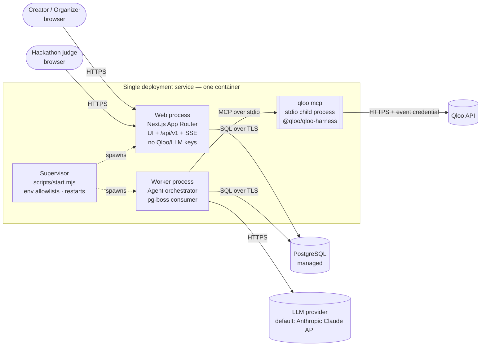
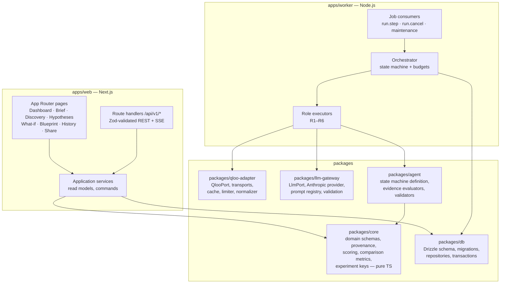
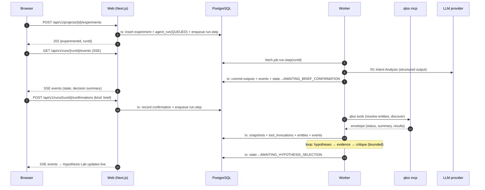
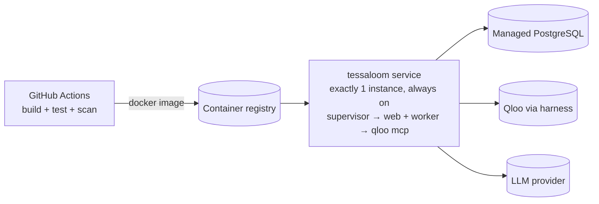

# Tessaloom — System Architecture

> **Status:** Architecture baseline v1.1 (pre-implementation; reviewed 2026-10-20: single-service deployment per [ADR-017](DECISIONS.md#adr-017-single-deployment-service-with-two-supervised-processes), LLM configuration per [ADR-018](DECISIONS.md#adr-018-llm-model-verification-fallback-model-cost-model-and-credentials))
> **Date:** 2026-10-20
> **Submission deadline:** Friday, October 30, 2026, 11:45 PM EDT (UTC−4), which is 2026-10-31 03:45 UTC
> **Engineering window:** about 10 calendar days, solo developer, assisted by Claude Code and OpenAI Codex
> **Related documents:** [PRD](PRD.md) · [Agent workflow](AGENT_WORKFLOW.md) · [API contracts](API_CONTRACTS.md) · [Database schema](DATABASE_SCHEMA.md) · [UI/UX spec](UI_UX_SPEC.md) · [Security](SECURITY.md) · [Test plan](TEST_PLAN.md) · [Implementation plan](IMPLEMENTATION_PLAN.md) · [Decisions](DECISIONS.md)

Every statement about Qloo behavior that we have not verified with a live credential is marked **PENDING LIVE VALIDATION**. The full list of sources and their limits is in [API_CONTRACTS.md §2](API_CONTRACTS.md#2-research-sources-and-limitations).

---

## 1. Architectural summary

Tessaloom is an **agentic cultural experimentation studio**. A user writes a creative brief that names several cultural interests. The system then:

1. resolves those interests into confirmed Qloo entities and tags;
2. generates *cultural collision hypotheses*: unexpected cross-domain combinations;
3. turns each hypothesis into testable claims;
4. collects evidence for each claim through Qloo;
5. grades claims with deterministic rules and an LLM critic;
6. lets the user branch the experiment by changing cultural variables. Only the affected Qloo queries are recomputed;
7. composes an evidence-traceable experience blueprint.

The system is a **modular monolith**:

- **Language and runtime:** one TypeScript codebase in a pnpm workspace.
- **Processes:** a Next.js web process and a Node.js worker process, both built from the same Docker image and run in **one deployment service** (one container) under a small supervisor. Each process receives only its own environment allowlist ([ADR-017](DECISIONS.md#adr-017-single-deployment-service-with-two-supervised-processes)).
- **Data store:** one PostgreSQL database.
- **No other infrastructure.** No microservices, Redis, separate vector store, or multi-agent framework.

The most important constraint comes from the official Qloo hackathon kit:

> **Constraint C-1:** For the event, the supported ways to call Qloo are `qloo explore`, `qloo exec`, `qloo api`, and `qloo mcp` from the public `@qloo/qloo-harness` npm package (minimum version 0.1.26). The kit's MCP starter says: *"Serverless functions are not a supported route."* The backend must run on a VM or container with Node.js ≥ 22.19 and the harness installed.

So Tessaloom does **not** use Vercel/Netlify serverless functions for Qloo access. All Qloo traffic goes through a long-running worker process that holds a persistent `qloo mcp` stdio child process.

---

## 2. Context diagram



Trust boundaries:

- **The browser never talks to Qloo or the LLM provider.**
- **The web process has no Qloo key and no LLM key.** The supervisor starts it with an environment allowlist that excludes them and a controlled executable PATH. M0 enforces configured non-root child UIDs when the supervisor runs as root, with distinct UIDs for web and worker; missing identities fail before any spawn. Only the worker holds provider keys (see [SECURITY.md §3](SECURITY.md#3-credential-management)).
- **The two processes communicate only through PostgreSQL:** job queue rows, run state, and an append-only event log.

---

## 3. Container and module view



### 3.1 Repository layout (target)

```
tessaloom/
├─ apps/
│  ├─ web/                 # Next.js App Router (UI, /api/v1, SSE)
│  └─ worker/              # Long-running job consumer + orchestrator host
├─ packages/
│  ├─ core/                # Zod domain schemas, enums, provenance, scoring, metrics (no I/O)
│  ├─ db/                  # Drizzle schema, migrations, repositories
│  ├─ qloo-adapter/        # QlooPort + HarnessMcpTransport / HarnessCliTransport / FixtureTransport
│  ├─ llm-gateway/         # LlmPort + AnthropicProvider + prompt registry
│  ├─ agent/               # State machine, role contracts, evaluators, validators
│  └─ config/              # Shared tsconfig, ESLint, Vitest presets
├─ fixtures/
│  └─ qloo/                # DEVELOPMENT FIXTURES ONLY (synthetic, clearly labeled)
├─ e2e/                    # Playwright specs
├─ scripts/
│  └─ start.mjs            # Process supervisor (env allowlists, restarts, signal forwarding)
├─ docs/                   # This documentation set
├─ Dockerfile              # One image, one service (supervisor → web + worker)
├─ docker-compose.yml      # Local Postgres (+ optional worker/web)
└─ .github/workflows/      # CI, security scans, optional live smoke test
```

### 3.2 Module responsibilities

| Package | Responsibility | Allowed dependencies | Forbidden |
|---|---|---|---|
| `core` | Domain types, Zod schemas, provenance enums, deterministic scoring and comparison math, experiment-key hashing | `zod`, a JCS canonicalization helper | Any I/O, React, DB, network |
| `db` | Table definitions, migrations, repositories, transaction helpers | `core`, `drizzle-orm`, `pg` | Business decisions |
| `qloo-adapter` | The only gateway to Qloo; transport selection; response normalization; caching; rate limiting; data-origin labeling | `core`, `@modelcontextprotocol/sdk`, `db` (cache repository) | LLM calls; UI |
| `llm-gateway` | The only gateway to LLMs; structured output; schema validation; repair retry; token accounting; prompt versioning | `core`, `@anthropic-ai/sdk` | Qloo calls |
| `agent` | State definitions, transition guards, role input/output contracts, evidence evaluators, hallucination validators | `core` | Direct DB/network access (inputs are injected) |
| `apps/worker` | Hosts the orchestrator: loads state, runs one step, commits, enqueues the next | all packages | Serving HTTP to the public |
| `apps/web` | UI, REST API, SSE event streaming, share views | `core`, `db` | Importing `qloo-adapter` or `llm-gateway` (enforced by ESLint `no-restricted-imports`) |
| `scripts/start.mjs` | Supervisor: spawns `web` and `worker` with env allowlists (and UIDs when possible), restarts them, forwards signals | Node built-ins only | Importing application packages; serving traffic; logging env values |

---

## 4. The eight product modules mapped to the architecture

| # | Product module | Primary code location | Key data | Key UI |
|---|---|---|---|---|
| 1 | **Cultural Intelligence** | `qloo-adapter`, `agent/roles/discovery`, `agent/roles/intent` | `cultural_entities`, `entity_resolution_records`, `qloo_response_snapshots`, `tool_invocations` | Creative Brief, Discovery Canvas |
| 2 | **Cultural Collision Engine** | `agent/collision` (candidate pool and selection), `core/scoring/novelty` | `collision_candidates`, `hypotheses` | Discovery Canvas (tension slider), Hypothesis Lab |
| 3 | **Creative Hypothesis Lab** | `agent/roles/hypothesis`, `agent/roles/critic`, `agent/evaluators/*` | `hypotheses`, `hypothesis_claims`, `evidence_records` | Hypothesis Lab |
| 4 | **Interactive Cultural Evidence Graph** | `core/graph` (graph projection), `apps/web/features/graph` | Derived from `cultural_entities`, `entity_relations`, `hypotheses`, `evidence_records`; `graph_layouts` | Discovery Canvas, Hypothesis Lab (graph tab), Share View |
| 5 | **What-if Experimentation Simulator** | `agent/roles/counterfactual`, `core/experiment/delta`, `core/metrics/compare` | `experiments`, `counterfactual_branches`, `experiment_comparisons` | What-if Lab |
| 6 | **Experience Blueprint Composer** | `agent/roles/composer`, `core/blueprint` | `experience_blueprints`, `blueprint_revisions` | Experience Blueprint |
| 7 | **Agent Activity Monitor** | `agent/events`, `apps/web/app/api/v1/runs/[runId]/events` (SSE route for `GET /api/v1/runs/:runId/events`) | `agent_runs`, `run_events`, `tool_invocations`, `llm_invocations` | Activity dock on every project page |
| 8 | **Persistent Project Workspace** | `db` repositories, `apps/web/features/projects` | `workspaces`, `projects`, `share_links`, all versioned rows | Home Dashboard, Project History, Share View |

---

## 5. Technology decisions (final)

Detailed rationale and rejected alternatives are in [DECISIONS.md](DECISIONS.md).

| Concern | Decision | Notes |
|---|---|---|
| Runtime | **Node.js 22 LTS, minimum 22.19.0** | Required by `@qloo/qloo-harness` (`engines: node >=22.19.0`) |
| Package manager | **pnpm workspaces** | Monorepo-style without a build orchestrator. Turborepo is optional and not required. |
| Web framework | **Next.js (App Router), current stable major pinned exactly at scaffold time**, React 19 | Run with `next start` (Node server, `output: "standalone"`), **not** serverless |
| Language | **TypeScript** in `strict` mode | `noUncheckedIndexedAccess` enabled |
| Styling | **Tailwind CSS** + **shadcn/ui** (Radix primitives) | Design tokens in CSS variables. See [UI_UX_SPEC.md](UI_UX_SPEC.md) |
| Graph | **React Flow** (`@xyflow/react`) | Custom node types per provenance class |
| Charts | **Recharts** | Budget meters, comparison charts, score breakdowns |
| Validation | **Zod** | One schema source for API I/O, LLM structured outputs, DB JSON columns |
| ORM | **Drizzle ORM** + `drizzle-kit` migrations on `node-postgres` | See [DECISIONS.md ADR-004](DECISIONS.md#adr-004-drizzle-orm-instead-of-prisma) |
| Database | **PostgreSQL 16+**, managed (default: Neon) | TLS required. Two DB roles (migrator, app). |
| Job queue | **pg-boss** (PostgreSQL-backed) | No Redis. Gives retries, singleton keys, and scheduling. |
| Qloo access | **`@qloo/qloo-harness` pinned to 0.1.26 or newer**, primarily `qloo mcp` over stdio via `@modelcontextprotocol/sdk` | `qloo exec` / `qloo api` as a secondary transport. Development fixtures are dev/test only. |
| LLM | **Provider-agnostic `LlmPort`**. Default implementation: **Anthropic Claude API**, primary model `claude-opus-5-5` (`LLM_MODEL`), configurable fallback `claude-sonnet-5-5` (`LLM_FALLBACK_MODEL`). Both IDs were verified against the official models overview on 2026-10-20 (ADR-018). | Structured outputs (`output_config.format` / SDK `messages.parse` with Zod), adaptive thinking with an explicit `effort` per role, and server-side refusal fallback. See §8. |
| Realtime | **Server-Sent Events** from a Next.js route handler | Resumable via `Last-Event-ID` |
| Unit/integration tests | **Vitest** | Integration tests use a real Postgres (Docker service in CI) |
| E2E tests | **Playwright** | Run against fixture mode in CI and against the deployed URL for smoke tests |
| CI/CD | **GitHub Actions** | Lint, typecheck, unit, integration, E2E, gitleaks, dependency audit, CodeQL |
| Hosting | **One always-on container service** (default: Fly.io) running the web and worker processes under a supervisor, with per-process env allowlists ([ADR-017](DECISIONS.md#adr-017-single-deployment-service-with-two-supervised-processes)) | The alternative is Render (one Docker web service). The final choice should be confirmed in M0. The same image can be split into two services later via `TL_ROLE`. |

### 5.1 Runtime LLM access is a separate cost

Claude Code and OpenAI Codex are **development tools only**. Their subscriptions do **not** provide runtime API access for the deployed app. The hosted Tessaloom needs its own Claude API key from the Claude Console, in an organization with billing or prepaid credits and a workspace spend limit. The key is passed only to the worker process.

The estimated cost is about $1.09 per typical exploration run on Opus 5.5, with a recommended $150 prepaid event budget. The cost model and credential requirements are in [ADR-018](DECISIONS.md#adr-018-llm-model-verification-fallback-model-cost-model-and-credentials), and the risk is tracked as [R-05](DECISIONS.md#5-risk-register).

---

## 6. Runtime architecture

### 6.1 Processes

All long-running processes live in **one deployment service, with exactly one instance** (ADR-017).

| Process | Command | Started by | Lifecycle | Secrets it receives (allowlist) |
|---|---|---|---|---|
| `supervisor` | `tini -- node scripts/start.mjs` (PID 1 + supervisor) | Container entrypoint | Serves no traffic. Restarts children with backoff. Exits after more than 5 crashes in 5 min so the platform restarts the container. Forwards SIGTERM. | Holds the full platform env in memory; logs only variable **names** |
| `web` | `node apps/web/server.js` (Next standalone) | Supervisor (UID `tl-web` when a root start is possible) | Restarted by the supervisor | `DATABASE_URL` (app role), `SESSION_SECRET`, `SHARE_TOKEN_PEPPER`, `ADMIN_TOKEN` (optional) + non-secret config. **Never** `QLOO_*` secrets or `*_API_KEY`. |
| `worker` | `node apps/worker/dist/main.js` | Supervisor (UID `tl-worker` when a root start is possible) | Restarted by the supervisor. **Exactly one** (single Qloo credential and quota; in-process rate limiter). | `DATABASE_URL` (app role), `QLOO_API_KEY`, `QLOO_HOME`, `ANTHROPIC_API_KEY` (default LLM provider), `LLM_MODEL`, `LLM_FALLBACK_MODEL`, quota settings |
| `qloo mcp` | Child process spawned by the worker: `qloo mcp` with `env: process.env` (the worker's already-filtered env) | Worker | 1 per worker, restarted on exit with backoff | Inherits `QLOO_API_KEY`, `QLOO_HOME` |
| `migrate` | `pnpm db:migrate` (platform release / pre-deploy command) | Platform, before the new version starts | One-shot | `DATABASE_URL_MIGRATOR` (not in either child's allowlist) |

**Scaling path.** The image honors `TL_ROLE=all|web|worker` (default `all`). Splitting into two services later requires configuration only, not code.

The worker passes `env: process.env` to `StdioClientTransport`. The kit warns that the MCP SDK otherwise forwards only a small default set of variables, which would leave `QLOO_API_KEY` out.

### 6.2 Long-running agent execution

Agent runs take tens of seconds to several minutes, which is longer than any HTTP request should block. The execution model is:

1. **Web** receives a command such as `POST /api/v1/projects/:id/experiments`. In a single transaction it inserts the experiment and an `agent_runs` row in state `QUEUED`, then enqueues a `run.step` job (singleton key = `runId`).
2. **Worker** picks up `run.step`, loads the run, verifies the expected `state_version`, and executes **exactly one state handler**. External calls (Qloo, LLM) happen *outside* any database transaction.
3. The worker then **commits atomically**: role outputs, tool invocation records, evidence, `run_events`, the state transition, `state_version + 1`, and usage counters.
4. If the next state is not terminal and does not wait for a human, the worker enqueues the next `run.step`. A state that waits for a human (`AWAITING_*`) ends the job, and a user command later enqueues the continuation.
5. **Web** streams `run_events` to the browser over SSE by polling `run_events WHERE run_id = $1 AND seq > $lastSeq` every 750 ms. This is simple and robust. Postgres `LISTEN/NOTIFY` is an optional optimization.

Properties of this design:

- **Crash safety.** A worker crash mid-step leaves the run at its last committed state. pg-boss retries the job, and the step's idempotency key (`runId:stateVersion`) prevents duplicate commits.
- **Cancellation.** The web process sets `cancel_requested_at`. The worker checks it before each external call and at step boundaries (see [AGENT_WORKFLOW.md §9](AGENT_WORKFLOW.md#9-cancellation)).
- **Budget enforcement.** Budgets are checked before every Qloo or LLM call (see [AGENT_WORKFLOW.md §7](AGENT_WORKFLOW.md#7-execution-budgets-and-iteration-limits)).

### 6.3 Request flow: start an exploration experiment



---

## 7. Qloo integration architecture (summary)

The full contract is in [API_CONTRACTS.md §5–§7](API_CONTRACTS.md#5-qloo-integration-contracts).

- **Port.** `QlooPort` is a narrow, typed interface with one method per *product capability*: `capabilities`, `findTags`, `searchEntities`, `describeEntity`, `entityTags`, `recommend`, `rank`, `wherePopular`, `compareAudiences`, `audienceDemographics`, `trends`.
- **Transports:**
  - `HarnessMcpTransport` (**primary**): a persistent `qloo mcp` child process; tools named `qloo_*`.
  - `HarnessCliTransport` (**secondary**): spawns `qloo exec <workflow>` or `qloo api <command> --json` per call. Used when a capability is not exposed as an MCP tool, or as a fallback if the MCP child is unhealthy.
  - `FixtureTransport` (**development/test only**): reads synthetic, labeled fixtures. **It refuses to load when `APP_ENV=production`.**
  - A direct REST transport to `api.qloo.com` is **not implemented**. The kit restricts the event to harness surfaces or "an organizer-approved authenticated gateway". If organizers explicitly approve direct REST, it can be added behind the same port ([DECISIONS.md ADR-003](DECISIONS.md#adr-003-qloo-access-through-the-official-harness-not-direct-rest)).
- **Result envelope.** Harness workflows return `status ∈ {ok, empty, needs_input, partial, degraded, error}`, `summary`, `results`, `result_count`, and on error `error.code`, `error.retryable`, `error.recovery` (confirmed from the kit's MCP starter). The adapter maps every status to a typed outcome and never converts an `error` into data.
- **No silent fallback.** If a live call fails, the agent records the failure and the claim stays `INCONCLUSIVE` or the run pauses. **Mock or fixture data is never substituted** for a failed live request ([API_CONTRACTS.md §6.4](API_CONTRACTS.md#64-fixture-policy-no-silent-substitution)).
- **Provenance.** Every Qloo-derived fact carries `toolInvocationId`, `snapshotId`, a JSON pointer into the raw result, `dataOrigin ∈ {LIVE, CACHE, REPLAY, FIXTURE}`, `retrievedAt`, and `harnessVersion`.
- **Item shapes are PENDING LIVE VALIDATION.** The tool input schemas and result item shapes are not yet confirmed. The adapter normalizes only fields that are actually present. Fields such as affinity and popularity are optional, and every normalizer has contract tests that must be re-recorded against live output.

---

## 8. LLM integration architecture (summary)

- **Port.** `LlmPort.generateStructured<T>({ role, promptId, promptVersion, input, schema, effort, budget })` returns `{ value: T, usage, modelId, invocationId }` or a typed failure.
- **Default provider: Anthropic Claude API**
  - Model `claude-opus-5-5` (configurable via `LLM_MODEL`; changing the model or tier is an owner decision recorded in `agent_runs.config_snapshot`).
  - Configurable fallback `claude-sonnet-5-5` (`LLM_FALLBACK_MODEL`). It is used for a whole step on provider unavailability, cost-budget pressure, or `LLM_MODE=economy`, and recorded per invocation (ADR-018).
  - Structured outputs through `output_config.format` (JSON Schema generated from Zod), parsed with the SDK `messages.parse` helper.
  - Adaptive thinking with **explicit `effort` per role**, because Claude Opus 5.5 defaults to `medium`. Starting values: R1 `low`, R2 `low`, R3 `high`, R4 `high`, R5 `medium`, R6 `medium`. These are tuned by measurement.
  - **No assistant prefill, no `temperature`.** Neither is supported on this model family. Reproducibility therefore comes from **recorded outputs**, not sampling settings (see [AGENT_WORKFLOW.md §14](AGENT_WORKFLOW.md#14-experiment-reproducibility)).
  - **No forced `tool_choice`.** It returns 400 on this model. Tessaloom does not need it, because roles return structured outputs and the orchestrator executes any proposed Qloo calls itself.
  - Server-side refusal fallback enabled (`fallbacks: "default"` with the `server-side-fallback-2026-07-01` beta). Every response's `stop_reason` is checked before its content is used.
  - Prompt caching on the stable system prompt and role instructions. Volatile content (brief, evidence) goes after the cache breakpoint.
  - Streaming for any call with large `max_tokens`. The `finalMessage()` helper collects the result.
- **The LLM never calls Qloo directly.** Roles *propose* typed evidence queries (`EvidenceQueryProposal`). The orchestrator validates each proposal against a per-state allowlist and the budget, then executes it through `QlooPort`. This keeps the agent evidence-driven, auditable, and cheap to test.
- **Untrusted content.** Brief text, Qloo results, and earlier model outputs are all treated as untrusted data in prompts. They are wrapped in delimited JSON blocks and never interpreted as instructions ([SECURITY.md §6](SECURITY.md#6-llm-and-prompt-injection-controls)).

---

## 9. Data architecture (summary)

The full schema is in [DATABASE_SCHEMA.md](DATABASE_SCHEMA.md).

- **Identifiers.** Primary keys are UUIDv7, generated in the application and time-ordered. *Deterministic experiment keys* are `sha256(JCS(experimentDefinition))` as 64 lowercase hex characters. Qloo entity IDs are stored as `qloo_id` text, exactly as returned.
- **Versioning.** Briefs, blueprints, and prompt templates are **append-only revisions** with a `current_*_id` pointer. Run outputs are immutable once committed. Experiments are immutable after completion; any change creates a **counterfactual branch** (a child experiment).
- **Provenance.** Every displayable fact row has a `provenance_class` column. `CHECK` constraints prevent a `QLOO_SOURCED` row from existing without a `tool_invocation_id`.
- **Minimal personal data.** No names, emails, or passwords are required. A workspace is identified by a random 256-bit secret held in an httpOnly cookie, and only its hash is stored.

---

## 10. Frontend architecture (summary)

The full specification is in [UI_UX_SPEC.md](UI_UX_SPEC.md).

- **Rendering.** React Server Components fetch read models directly from `db` repositories. Client components handle interactive surfaces: React Flow graph, sliders, comparison charts, SSE activity dock.
- **Mutations.** All mutations go through `/api/v1` route handlers. Server Actions are not used for agent commands, so that every command has an explicit, testable REST contract.
- **Route map:**

  | Route | Page |
  |---|---|
  | `/` | Home Dashboard |
  | `/projects/new` | New project |
  | `/projects/[projectId]/brief` | Creative Brief |
  | `/projects/[projectId]/discovery` | Discovery Canvas |
  | `/projects/[projectId]/hypotheses` | Hypothesis Lab |
  | `/projects/[projectId]/what-if` | What-if Lab |
  | `/projects/[projectId]/blueprint` | Experience Blueprint |
  | `/projects/[projectId]/history` | Project History |
  | `/share/[token]` | Read-only Share View |

- **Activity dock.** The Agent Activity Monitor is a persistent dock on all project pages, plus a full-screen view.

---

## 11. Deployment architecture



- **One image, one service.** The Dockerfile is based on Node 22.19+ (Debian slim). It installs `@qloo/qloo-harness@<pinned>` globally and `tini`. It creates the users `tl-web` and `tl-worker`, with `QLOO_HOME` owned by `tl-worker`. The supervisor starts the two children with separate env allowlists (ADR-017).
- **Sizing.** Start with 1 shared vCPU and 2 GB RAM, with per-child heap limits. Measure in M10 (R-16).
- **Health check.** The platform HTTP check targets `GET /api/health/ready`. It fails if the DB is unreachable or the worker heartbeat is older than 30 s, so a stuck worker leads to a container restart.
- **Release step.** Migrations run with the migrator role (platform release / pre-deploy command) before the new version receives traffic.
- **Health endpoints:**
  - `GET /api/health`: liveness.
  - `GET /api/health/ready`: database reachable plus a recent worker heartbeat.
  - `GET /api/health/qloo`: the worker's last `qloo_capabilities` readiness result, which reveals no secrets.
- **Judging availability.** Auto-stop/scale-to-zero is **disabled** from submission through the judging period (**Nov 2–16, 2026**, externally verified), plus a buffer to Nov 30. See [HACKATHON_CHECKLIST.md §2.5](HACKATHON_CHECKLIST.md#25-deadlines-and-timing).
- **Demo resilience.** Seeded sample projects run in **REPLAY** mode from recorded *live* Qloo snapshots, labeled with their retrieval date. The judging demo therefore stays usable if the event quota is exhausted, without ever presenting fixtures as Qloo data. Whether we may store Qloo responses is **PENDING** confirmation of Qloo's terms ([DECISIONS.md R-08](DECISIONS.md#5-risk-register)).

---

## 12. Cross-cutting concerns

| Concern | Approach |
|---|---|
| Configuration | `packages/config/env.ts`: a Zod-validated environment schema per process. The process fails fast at boot on a missing or invalid variable. |
| Logging | Structured JSON logs (`pino`) with `runId`, `stepSeq`, `toolInvocationId`, and a request ID. A redaction list covers secrets and auth headers. |
| Tracing | A `trace_id` on each run, propagated into tool and LLM invocation rows. OpenTelemetry export is optional and out of the critical path. |
| Rate limiting | Qloo: an in-worker token bucket plus a Postgres daily quota counter. Public API: per-workspace and per-IP limits on run-starting endpoints. |
| Cost control | Global daily LLM spend cap and Qloo call cap (`usage_counters`). Once a cap is reached, new live runs are refused with a clear message, and replay/sample projects keep working. |
| Error model | Typed `AppError` with `code`, `retryable`, `userMessage`, and `details`. The API error envelope is in [API_CONTRACTS.md §3.3](API_CONTRACTS.md#33-error-envelope). |
| Accessibility | WCAG 2.2 AA target. Provenance is never encoded by color alone. The graph has a list/table alternative. |
| Internationalization | English only, with copy kept in one module to allow later localization. |

---

## 13. Key constraints and assumptions

| ID | Constraint / assumption | Status |
|---|---|---|
| C-1 | Live Qloo calls must use harness surfaces. Serverless is not supported. | **Confirmed** (kit README, MCP starter, API_ACCESS.md) |
| C-2 | Node ≥ 22.19.0 and harness ≥ 0.1.26 | **Confirmed** (kit README, npm metadata: latest `0.1.26`, modified 2026-09-23) |
| C-3 | The Qloo credential is individually attributable and must not be shared or placed in browsers, repos, or recordings | **Confirmed** (kit API_ACCESS.md, SAFE_USE.md) |
| C-4 | The event quota, rate limit, and credential expiration are published by organizers | **Unknown.** Not yet published to us. **PENDING.** |
| C-5 | MCP tool input schemas and result item shapes | **PENDING LIVE VALIDATION.** Discover them via `listTools()` and recorded outputs. |
| C-6 | The credential stays valid through the judging period (Nov 2–16, 2026) | **Unverified.** Organizer confirmation is required. |
| C-7 | Devpost official rules | **Key facts externally verified by the owner** against the official rules page: deadline, individual participation, working app with meaningful Qloo integration, public demo, public open-source repo with a detectable license, English description, video not mandatory, judging Nov 2–16, four equally weighted criteria. The assistant could not fetch the page (bot protection). See [HACKATHON_CHECKLIST.md §1.1](HACKATHON_CHECKLIST.md#11-rules-facts-confirmed-from-the-official-rules-externally-verified). |
| C-9 | One deployment service with exactly one instance (web + worker supervised) | **Decided** (ADR-017) |
| C-10 | `claude-opus-5-5` and `claude-sonnet-5-5` are current Claude API model IDs | **Confirmed (official docs, 2026-10-20).** Account access is verified in M3 with the owner's key. |
| C-8 | Storing and replaying Qloo responses is permitted | **Unverified.** The kit says "Cache only what your project needs." Terms review is pending. |
