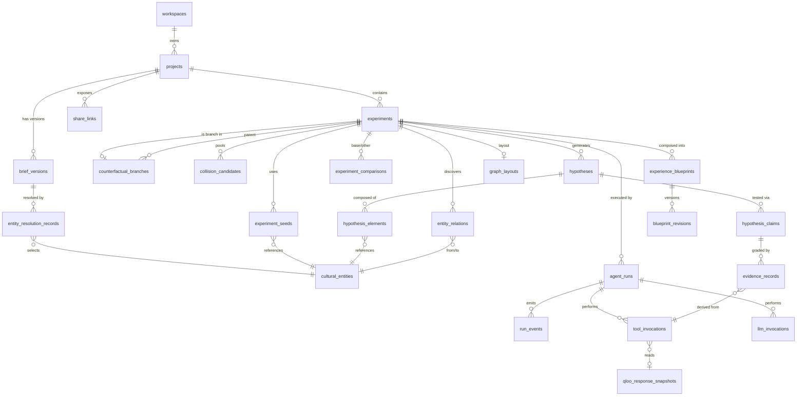

# Tessaloom — Database Schema

> **Status:** v1.2 · 2026-10-21 · **Implemented in M1** (`packages/db/src/schema.ts`, migrations `0000`–`0001`). §11 lists where the implementation refines this document using V1 evidence.
> **Engine:** PostgreSQL 16+ · **ORM:** Drizzle ORM (`drizzle-orm/pg-core`) + `drizzle-kit` migrations
> **Related:** [ARCHITECTURE.md §9](ARCHITECTURE.md#9-data-architecture-summary) · [AGENT_WORKFLOW.md](AGENT_WORKFLOW.md) · [SECURITY.md](SECURITY.md)

---

## 1. Conventions

| Topic | Convention |
|---|---|
| Table names | `snake_case`, plural |
| Primary keys | `id uuid` = **UUIDv7**, generated in the application (`packages/core/src/ids.ts`). Time-ordered, so B-tree inserts stay index-friendly. |
| Deterministic keys | `experiment_key char(64)` = `sha256Hex(JCS(ExperimentDefinition))`. `request_hash char(64)` = `sha256Hex(JCS({workflow, args, harnessVersion}))`. `content_hash char(64)` on versioned documents. |
| External IDs | `qloo_id text` stores the identifier exactly as Qloo returns it. Format is 🟡 PENDING LIVE VALIDATION; the docs show UUID-style entity IDs and URN-style tag IDs. |
| Timestamps | `timestamptz`, UTC. `created_at` defaults to `now()`. Most rows are append-only, so there is no `updated_at`; mutable rows have `updated_at`. |
| Enums | PostgreSQL `enum` types generated from the Zod enums in `packages/core`. New values are added via migration only. |
| JSON | `jsonb`, always validated by a Zod schema at write time. JSON columns hold **payloads**. Anything queried or joined on is a real column. |
| Soft delete | Not used for experiment data (immutability). Projects use `status = 'archived'`. Hard deletion happens through the retention job (§7). |
| Foreign keys | Always declared, `ON DELETE CASCADE` from workspace → project → children, so retention purges are simple and complete. `ON DELETE RESTRICT` where history must be kept (for example, a snapshot still referenced by evidence). |
| Money / cost | `numeric(10,4)` in USD for LLM cost estimates |

---

## 2. Enumerated types

```sql
CREATE TYPE project_status        AS ENUM ('active','archived');
CREATE TYPE use_case              AS ENUM ('bookstore','cafe','venue','community_event','other');
CREATE TYPE venue_type            AS ENUM ('bookstore','cafe','bar','gallery','library','small_venue','outdoor','online','other');
CREATE TYPE entity_kind           AS ENUM ('entity','tag','locality');
CREATE TYPE resolution_status     AS ENUM ('PENDING','RESOLVED','AMBIGUOUS','UNRESOLVED','EXCLUDED'); -- PENDING: ad hoc resolve job queued (API_CONTRACTS §4.7)
CREATE TYPE resolution_method     AS ENUM ('EXACT_SINGLE','USER_SELECTED','USER_REFINED','SAMPLE_PRESET');
CREATE TYPE experiment_kind       AS ENUM ('ROOT','BRANCH');
CREATE TYPE experiment_status     AS ENUM ('PENDING','RUNNING','PAUSED','COMPLETED','COMPLETED_WITH_LIMITS','FAILED','CANCELLED');
CREATE TYPE run_kind              AS ENUM ('EXPLORATION','COUNTERFACTUAL','COMPOSITION','REVALIDATION');
CREATE TYPE run_state             AS ENUM (/* full list in AGENT_WORKFLOW.md §4 */);
CREATE TYPE data_origin           AS ENUM ('LIVE','CACHE','REPLAY','FIXTURE');
CREATE TYPE qloo_transport        AS ENUM ('HARNESS_MCP','HARNESS_CLI','FIXTURE');
CREATE TYPE envelope_status       AS ENUM ('ok','empty','needs_input','partial','degraded','error','transport_error');
CREATE TYPE provenance_class      AS ENUM ('QLOO_SOURCED','APP_DERIVED','MODEL_INTERPRETATION','CREATIVE_SPECULATION','USER_PROVIDED','DEVELOPMENT_FIXTURE');
CREATE TYPE hypothesis_status     AS ENUM ('SPECULATIVE','UNDER_INVESTIGATION','SUPPORTED','PARTIALLY_SUPPORTED','CONTRADICTED','INCONCLUSIVE','UNTESTABLE');
CREATE TYPE claim_test_kind       AS ENUM ('CROSS_DOMAIN_AFFINITY','SHORTLIST_FIT','AUDIENCE_BRIDGE','TAG_RESONANCE','LOCATION_FIT','MOMENTUM','AUDIENCE_PROFILE');
CREATE TYPE claim_status          AS ENUM ('PLANNED','TESTED','UNTESTED_BUDGET','FAILED');
CREATE TYPE evidence_stance       AS ENUM ('SUPPORTS','CONTRADICTS','NEUTRAL','INSUFFICIENT');
CREATE TYPE relation_kind         AS ENUM ('THREAD','BRIDGE_SHARED_TAG','BRIDGE_CO_OCCURRENCE','HAS_TAG','POPULAR_IN');
CREATE TYPE blueprint_status      AS ENUM ('DRAFT','ACCEPTED');
CREATE TYPE revision_author       AS ENUM ('AGENT','USER');
CREATE TYPE share_scope           AS ENUM ('project','experiment','blueprint');
CREATE TYPE llm_validation_status AS ENUM ('VALID','REPAIRED','INVALID','REFUSED','TRUNCATED');
```

---

## 3. Entity-relationship overview



---

## 4. Tables

Column notation: **PK** primary key, **FK** foreign key, **U** unique, **NN** not null. All `id` columns are `uuid PK NN`. All `created_at` columns are `timestamptz NN default now()`.

### 4.1 `workspaces`

An anonymous owner of projects. **No personal data.**

| Column | Type | Constraints | Notes |
|---|---|---|---|
| `id` | uuid | PK | |
| `secret_hash` | char(64) | U, NN | HMAC-SHA-256(cookie secret, `SESSION_SECRET`) |
| `kind` | text | NN, CHECK in (`'anonymous'`,`'system'`) | `system` owns the sample projects |
| `created_at` | timestamptz | NN | |
| `last_seen_at` | timestamptz | NN | Updated at most hourly |

Indexes: `U(secret_hash)`, `(last_seen_at)` for retention.

### 4.2 `projects`

| Column | Type | Constraints | Notes |
|---|---|---|---|
| `id` | uuid | PK | |
| `workspace_id` | uuid | FK → workspaces ON DELETE CASCADE, NN | |
| `name` | text | NN, CHECK length 1–80 | |
| `use_case` | use_case | NN | |
| `status` | project_status | NN default `'active'` | |
| `current_brief_version_id` | uuid | FK → brief_versions (deferrable), NULL | Pointer to the latest version |
| `sample_source_id` | text | NULL | Set when forked from a sample |
| `created_at`, `updated_at` | timestamptz | NN | |

Indexes: `(workspace_id, status, updated_at DESC)`.

### 4.3 `brief_versions` (creative briefs, append-only)

| Column | Type | Constraints | Notes |
|---|---|---|---|
| `id` | uuid | PK | |
| `project_id` | uuid | FK → projects CASCADE, NN | |
| `version` | integer | NN, CHECK ≥ 1 | U(project_id, version) |
| `content` | jsonb | NN | `BriefInput` (validated) |
| `content_hash` | char(64) | NN | sha256(JCS(content)) |
| `intent_frame` | jsonb | NULL | `IntentFrame` from R1 (MODEL_INTERPRETATION) |
| `intent_llm_invocation_id` | uuid | FK → llm_invocations, NULL | |
| `confirmed_at` | timestamptz | NULL | Gate H1 |
| `created_at` | timestamptz | NN | |

Indexes: `U(project_id, version)`, `(project_id, created_at DESC)`.

### 4.4 `cultural_entities`

Canonical local records of Qloo entities, tags, and localities, scoped per workspace. Scoping prevents cross-tenant leakage of user-chosen entities and keeps retention simple.

| Column | Type | Constraints | Notes |
|---|---|---|---|
| `id` | uuid | PK | |
| `workspace_id` | uuid | FK → workspaces CASCADE, NN | |
| `kind` | entity_kind | NN | |
| `qloo_id` | text | NN | As returned by Qloo |
| `qloo_type` | text | NULL | For example `urn:entity:book` (🟡 format) |
| `domain` | text | NULL | Normalized Tessaloom `Domain` |
| `name` | text | NN | |
| `snapshot` | jsonb | NN | Normalized fields actually returned (`NormalizedEntity`), including `missingFields[]` |
| `source_tool_invocation_id` | uuid | FK → tool_invocations, NULL | First retrieval |
| `provenance_class` | provenance_class | NN, CHECK in (`'QLOO_SOURCED'`,`'DEVELOPMENT_FIXTURE'`) | |
| `first_seen_at`, `last_refreshed_at` | timestamptz | NN | |

Indexes: `U(workspace_id, kind, qloo_id)`, `(workspace_id, domain)`, GIN on `to_tsvector('simple', name)` (local typeahead).

### 4.5 `entity_resolution_records`

Traceable mapping from user text to a confirmed entity or tag.

| Column | Type | Constraints | Notes |
|---|---|---|---|
| `id` | uuid | PK | |
| `brief_version_id` | uuid | FK → brief_versions CASCADE, NULL | NULL for ad hoc What-if resolutions |
| `project_id` | uuid | FK → projects CASCADE, NN | |
| `run_id` | uuid | FK → agent_runs, NULL | |
| `interest_index` | integer | NULL | Index into `brief.interests` |
| `input_text` | text | NN, CHECK length 1–120 | |
| `domain_hint` | text | NULL | |
| `requested_kind` | entity_kind | NN default `'entity'` | `entity` / `tag` / `locality` (matches the API `kind`) |
| `candidates` | jsonb | NN default `'[]'` | `[{ entityId, qlooId, name, type, detailFields, rankInResponse }]` (QLOO_SOURCED); empty while `PENDING` |
| `status` | resolution_status | NN | |
| `method` | resolution_method | NULL | Set once resolved |
| `selected_entity_id` | uuid | FK → cultural_entities, NULL | CHECK: NN when status = RESOLVED |
| `tool_invocation_ids` | uuid[] | NN default `{}` | |
| `confirmed_at` | timestamptz | NULL | |
| `created_at` | timestamptz | NN | |

Indexes: `(brief_version_id, interest_index)`, `(project_id, created_at DESC)`.

### 4.6 `experiments` (experiment sessions)

Immutable definition plus lifecycle status. A branch is itself an experiment (`kind = 'BRANCH'`).

| Column | Type | Constraints | Notes |
|---|---|---|---|
| `id` | uuid | PK | |
| `project_id` | uuid | FK → projects CASCADE, NN | |
| `brief_version_id` | uuid | FK → brief_versions RESTRICT, NN | |
| `kind` | experiment_kind | NN | |
| `parent_experiment_id` | uuid | FK → experiments RESTRICT, NULL | CHECK: NN iff kind = BRANCH |
| `root_experiment_id` | uuid | FK → experiments, NULL | Fast tree queries (self for roots, set after insert) |
| `experiment_key` | char(64) | NN | Deterministic. U(project_id, experiment_key). |
| `definition` | jsonb | NN | Full `ExperimentDefinition` (AGENT_WORKFLOW §14.1) |
| `label` | text | NULL, CHECK length ≤ 80 | For example "Porto instead of Lisbon" |
| `status` | experiment_status | NN | Derived from the latest run |
| `mode` | text | NN, CHECK in (`'live'`,`'replay'`,`'fixture'`) | |
| `created_at` | timestamptz | NN | |
| `completed_at` | timestamptz | NULL | |

Indexes: `U(project_id, experiment_key)`, `(project_id, created_at DESC)`, `(parent_experiment_id)`, `(root_experiment_id)`.

### 4.7 `experiment_seeds`

| Column | Type | Constraints |
|---|---|---|
| `experiment_id` | uuid | FK → experiments CASCADE, NN |
| `entity_id` | uuid | FK → cultural_entities RESTRICT, NN |
| `role` | text | NN, CHECK in (`'seed'`,`'tag_constraint'`,`'location'`) |
| `ordinal` | smallint | NN |

PK `(experiment_id, entity_id, role)`.

### 4.8 `counterfactual_branches`

| Column | Type | Constraints | Notes |
|---|---|---|---|
| `id` | uuid | PK | |
| `parent_experiment_id` | uuid | FK → experiments RESTRICT, NN | |
| `branch_experiment_id` | uuid | FK → experiments CASCADE, U, NN | |
| `variable_delta` | jsonb | NN | `VariableDelta` |
| `mode` | text | NN, CHECK in (`'hold_hypotheses'`,`'regenerate'`) | |
| `planned_dirty_queries` | integer | NN, CHECK ≥ 0 | |
| `planned_reused_queries` | integer | NN, CHECK ≥ 0 | |
| `created_at` | timestamptz | NN | |

Indexes: `(parent_experiment_id, created_at DESC)`.

### 4.9 `agent_runs`

| Column | Type | Constraints | Notes |
|---|---|---|---|
| `id` | uuid | PK | |
| `experiment_id` | uuid | FK → experiments CASCADE, NN | |
| `blueprint_id` | uuid | FK → experience_blueprints CASCADE, NULL | For COMPOSITION runs |
| `kind` | run_kind | NN | |
| `state` | run_state | NN | |
| `state_version` | integer | NN default 0 | Optimistic concurrency |
| `iteration` | smallint | NN default 0, CHECK 0–10 | |
| `budget` | jsonb | NN | `RunBudget` (immutable) |
| `usage` | jsonb | NN | `RunUsage` counters |
| `config_snapshot` | jsonb | NN | Model, effort per role, prompt versions, adapter/harness/ruleset versions |
| `pending_confirmation` | jsonb | NULL | `ConfirmationRequest` |
| `cancel_requested_at` | timestamptz | NULL | |
| `terminal_reason` | text | NULL | Code, for example `BUDGET_QLOO_CALLS` |
| `error` | jsonb | NULL | `{ code, message, retryable }` (redacted) |
| `trace_id` | char(32) | NN | |
| `started_at`, `finished_at` | timestamptz | | |
| `created_at` | timestamptz | NN | |

Indexes: `(experiment_id, created_at DESC)`, partial `(state) WHERE state NOT IN ('COMPLETED','COMPLETED_WITH_LIMITS','FAILED','CANCELLED')` for the active-run dashboard and the expiry job.

### 4.10 `run_events` (append-only activity log)

| Column | Type | Constraints | Notes |
|---|---|---|---|
| `run_id` | uuid | FK → agent_runs CASCADE, NN | |
| `seq` | integer | NN | PK(run_id, seq) |
| `ts` | timestamptz | NN | |
| `type` | text | NN | Event type (AGENT_WORKFLOW §17.1) |
| `state` | run_state | NN | |
| `role` | text | NULL | R1–R6 |
| `summary` | text | NN, CHECK length ≤ 280 | |
| `payload` | jsonb | NN default `'{}'` | Redacted, typed per event |

Index: the PK serves SSE polling (`WHERE run_id = $1 AND seq > $2 ORDER BY seq`).

### 4.11 `qloo_response_snapshots`

| Column | Type | Constraints | Notes |
|---|---|---|---|
| `id` | uuid | PK | |
| `request_hash` | char(64) | NN | |
| `workflow` | text | NN | For example `qloo_recommend` |
| `transport` | qloo_transport | NN | |
| `harness_version` | text | NN | |
| `envelope_status` | envelope_status | NN | |
| `raw` | jsonb | NN | The **full** envelope as received (no secrets are present in envelopes) |
| `raw_bytes` | integer | NN, CHECK ≤ 2 000 000 | Guard against oversized payloads |
| `is_fixture` | boolean | NN | |
| `retrieved_at` | timestamptz | NN | |
| `expires_at` | timestamptz | NN | Cache TTL |
| `pinned` | boolean | NN default false | Pinned snapshots (referenced by sample projects or the share view) are kept |

Indexes: `(request_hash, retrieved_at DESC)`, `(expires_at) WHERE NOT pinned`.

### 4.12 `tool_invocations`

| Column | Type | Constraints | Notes |
|---|---|---|---|
| `id` | uuid | PK | |
| `run_id` | uuid | FK → agent_runs CASCADE, NULL | NULL for ad hoc resolution jobs |
| `project_id` | uuid | FK → projects CASCADE, NN | |
| `step_seq` | integer | NULL | |
| `purpose` | text | NN | For example `claim:01J…` or `discovery:thread` |
| `method` | text | NN | `QlooPort` method |
| `workflow` | text | NN | Harness tool or command |
| `transport` | qloo_transport | NN | |
| `args_redacted` | jsonb | NN | Arguments (no secrets) |
| `request_hash` | char(64) | NN | |
| `snapshot_id` | uuid | FK → qloo_response_snapshots RESTRICT, NULL | NULL when no envelope was obtained |
| `data_origin` | data_origin | NN | |
| `cache_source_invocation_id` | uuid | FK → tool_invocations, NULL | CHECK: NN iff data_origin = CACHE |
| `envelope_status` | envelope_status | NN | |
| `result_count` | integer | NULL | |
| `error_code` | text | NULL | |
| `attempt` | smallint | NN default 1 | |
| `latency_ms` | integer | NULL | |
| `created_at` | timestamptz | NN | |

Indexes: `(run_id, step_seq)`, `(project_id, created_at DESC)`, `(request_hash)`.

### 4.13 `llm_invocations`

| Column | Type | Constraints | Notes |
|---|---|---|---|
| `id` | uuid | PK | |
| `run_id` | uuid | FK → agent_runs CASCADE, NULL | |
| `project_id` | uuid | FK → projects CASCADE, NN | |
| `role` | text | NN | |
| `prompt_id`, `prompt_version` | text | NN | |
| `provider`, `model_id` | text | NN | `model_id` is the model actually used |
| `fallback_used` | boolean | NN default false | True when `LLM_FALLBACK_MODEL` served this step (ADR-018) |
| `effort` | text | NN | |
| `input_hash` | char(64) | NN | sha256 of the rendered request (system + messages + schema) |
| `input_excerpt` | jsonb | NN | Structured input data (brief/evidence IDs), **not** the full rendered prompt |
| `output` | jsonb | NULL | Parsed output (or the raw invalid output for debugging) |
| `validation_status` | llm_validation_status | NN | |
| `validation_errors` | jsonb | NULL | |
| `repair_of_id` | uuid | FK → llm_invocations, NULL | |
| `stop_reason` | text | NULL | |
| `input_tokens`, `cached_input_tokens`, `output_tokens` | integer | NN default 0 | |
| `estimated_cost_usd` | numeric(10,4) | NN default 0 | |
| `latency_ms` | integer | NULL | |
| `created_at` | timestamptz | NN | |

Indexes: `(run_id, created_at)`, `(project_id, created_at DESC)`.

### 4.14 `collision_candidates`

| Column | Type | Constraints | Notes |
|---|---|---|---|
| `id` | uuid | PK | |
| `experiment_id` | uuid | FK → experiments CASCADE, NN | |
| `element_entity_ids` | uuid[] | NN, CHECK cardinality 2–3 | |
| `bridge_relation_ids` | uuid[] | NN default `{}` | → entity_relations |
| `relevance`, `novelty`, `tension_fit` | real | NN, CHECK 0–1 | APP_DERIVED |
| `novelty_inputs` | text | NN, CHECK in (`'FULL'`,`'REDUCED_INPUTS'`) | |
| `selected` | boolean | NN | Chosen by MMR |
| `rank` | smallint | NULL | |

Index: `(experiment_id, selected, rank)`.

### 4.15 `entity_relations`

Relationships discovered from Qloo data, used by the evidence graph.

| Column | Type | Constraints | Notes |
|---|---|---|---|
| `id` | uuid | PK | |
| `experiment_id` | uuid | FK → experiments CASCADE, NN | |
| `from_entity_id`, `to_entity_id` | uuid | FK → cultural_entities, NN | CHECK from ≠ to |
| `kind` | relation_kind | NN | |
| `provenance_class` | provenance_class | NN | THREAD/HAS_TAG/POPULAR_IN = QLOO_SOURCED; BRIDGE_* = APP_DERIVED |
| `tool_invocation_ids` | uuid[] | NN, CHECK cardinality ≥ 1 | |
| `facts` | jsonb | NN | `[{ statement, jsonPointer, value, snapshotId }]` |
| `weight` | real | NULL | For example position-weighted presence |

Indexes: `(experiment_id, kind)`, `(from_entity_id)`, `(to_entity_id)`.

### 4.16 `hypotheses`

| Column | Type | Constraints | Notes |
|---|---|---|---|
| `id` | uuid | PK | |
| `experiment_id` | uuid | FK → experiments CASCADE, NN | |
| `run_id` | uuid | FK → agent_runs, NN | Producing run |
| `collision_candidate_id` | uuid | FK → collision_candidates, NULL | |
| `lineage_id` | uuid | NN | Stable across revisions (= id of the first version) |
| `revision_of_id` | uuid | FK → hypotheses, NULL | |
| `inherited_from_id` | uuid | FK → hypotheses, NULL | Set in hold-fixed branches (same hypothesis, re-evaluated) |
| `iteration` | smallint | NN | |
| `title` | text | NN, CHECK length 1–80 | MODEL_INTERPRETATION / CREATIVE_SPECULATION |
| `premise` | text | NN, CHECK length ≤ 400 | |
| `experience_sketch` | text | NN, CHECK length ≤ 600 | |
| `creative_elements` | jsonb | NN default `'[]'` | Each labeled CREATIVE_SPECULATION |
| `status` | hypothesis_status | NN | APP_DERIVED |
| `support_score`, `novelty_score`, `feasibility_score`, `composite_score` | real | NULL, CHECK 0–100 | APP_DERIVED |
| `score_breakdown` | jsonb | NULL | Inputs and weights |
| `scoring_version` | text | NN | |
| `retired` | boolean | NN default false | |
| `user_pinned` | boolean | NN default false | |
| `user_note` | text | NULL, CHECK length ≤ 500 | USER_PROVIDED |
| `llm_invocation_id` | uuid | FK → llm_invocations, NN | |
| `created_at` | timestamptz | NN | |

Indexes: `(experiment_id, retired, composite_score DESC)`, `(lineage_id, iteration)`.

### 4.17 `hypothesis_elements`

| Column | Type | Constraints |
|---|---|---|
| `hypothesis_id` | uuid | FK → hypotheses CASCADE, NN |
| `entity_id` | uuid | FK → cultural_entities RESTRICT, NN |
| `role` | text | NN, CHECK in (`'anchor'`,`'accent'`,`'context'`) |

PK `(hypothesis_id, entity_id)`.

### 4.18 `hypothesis_claims`

| Column | Type | Constraints | Notes |
|---|---|---|---|
| `id` | uuid | PK | |
| `hypothesis_id` | uuid | FK → hypotheses CASCADE, NN | |
| `ordinal` | smallint | NN | |
| `statement` | text | NN, CHECK length ≤ 200 | |
| `test_kind` | claim_test_kind | NN | |
| `test_params` | jsonb | NN | Typed per test kind; references entity UUIDs only |
| `status` | claim_status | NN | |
| `current_stance` | evidence_stance | NULL | The latest evaluator result |
| `depends_on` | text[] | NN | Variable paths for counterfactual dirty-checking |
| `query_request_hash` | char(64) | NULL | |

Indexes: `(hypothesis_id, ordinal)`, `(query_request_hash)`.

### 4.19 `evidence_records`

**This is the traceability core.** Every stance is linked to exactly one claim and at least one tool invocation.

| Column | Type | Constraints | Notes |
|---|---|---|---|
| `id` | uuid | PK | |
| `claim_id` | uuid | FK → hypothesis_claims CASCADE, NN | |
| `hypothesis_id` | uuid | FK → hypotheses CASCADE, NN | Denormalized for queries |
| `experiment_id` | uuid | FK → experiments CASCADE, NN | |
| `run_id` | uuid | FK → agent_runs, NN | |
| `tool_invocation_id` | uuid | FK → tool_invocations RESTRICT, NULL | |
| `stance` | evidence_stance | NN | Deterministic |
| `evaluator_id` | text | NN | For example `cross_domain_affinity.v1` |
| `ruleset_version` | text | NN | |
| `facts` | jsonb | NN | `[{ statement, jsonPointer, value, snapshotId }]` |
| `quality` | text | NN, CHECK in (`'FULL'`,`'PARTIAL'`,`'DEGRADED'`,`'FIELD_UNAVAILABLE'`,`'ERROR'`) | |
| `provenance_class` | provenance_class | NN | |
| `critic_note` | text | NULL, CHECK length ≤ 400 | MODEL_INTERPRETATION; must cite evidence |
| `critic_downgrade` | boolean | NN default false | |
| `created_at` | timestamptz | NN | |

Constraints:

- `CHECK (provenance_class <> 'QLOO_SOURCED' OR tool_invocation_id IS NOT NULL)`
- `CHECK (provenance_class IN ('QLOO_SOURCED','APP_DERIVED','DEVELOPMENT_FIXTURE'))`. Stances are never model-sourced.
- A trigger (or service-level check plus test) ensures that if the referenced invocation has `data_origin = 'FIXTURE'`, then `provenance_class = 'DEVELOPMENT_FIXTURE'`.

Indexes: `(hypothesis_id)`, `(claim_id, created_at DESC)`, `(experiment_id, stance)`, `(tool_invocation_id)`.

### 4.20 `experiment_comparisons`

| Column | Type | Constraints | Notes |
|---|---|---|---|
| `id` | uuid | PK | |
| `project_id` | uuid | FK → projects CASCADE, NN | |
| `base_experiment_id`, `other_experiment_id` | uuid | FK → experiments CASCADE, NN | CHECK base ≠ other |
| `comparison_kind` | text | NN, CHECK in (`'COUNTERFACTUAL'`,`'DATA_DRIFT'`,`'AD_HOC'`) | |
| `metrics` | jsonb | NN | `ComparisonMetrics` (APP_DERIVED) |
| `dirty_queries`, `reused_queries`, `new_qloo_results` | integer | NN | |
| `narrative` | jsonb | NULL | `{ blocks:[{ template, placeholders, evidenceIds }], llmInvocationId }` (MODEL_INTERPRETATION) |
| `metrics_version` | text | NN | |
| `created_at` | timestamptz | NN | |

Index: `U(base_experiment_id, other_experiment_id, metrics_version)`.

### 4.21 `experience_blueprints`

| Column | Type | Constraints | Notes |
|---|---|---|---|
| `id` | uuid | PK | |
| `project_id` | uuid | FK → projects CASCADE, NN | |
| `experiment_id` | uuid | FK → experiments RESTRICT, NN | |
| `hypothesis_ids` | uuid[] | NN, CHECK cardinality 1–3 | |
| `format` | text | NN, CHECK in (`'event'`,`'series'`,`'installation'`) | |
| `status` | blueprint_status | NN | |
| `current_revision_id` | uuid | FK → blueprint_revisions (deferrable), NULL | |
| `created_at`, `updated_at` | timestamptz | NN | |

Index: `(project_id, updated_at DESC)`.

### 4.22 `blueprint_revisions`

| Column | Type | Constraints | Notes |
|---|---|---|---|
| `id` | uuid | PK | |
| `blueprint_id` | uuid | FK → experience_blueprints CASCADE, NN | |
| `revision_number` | integer | NN | U(blueprint_id, revision_number) |
| `parent_revision_id` | uuid | FK → blueprint_revisions, NULL | |
| `author` | revision_author | NN | |
| `run_id` | uuid | FK → agent_runs, NULL | NN when author = AGENT |
| `content` | jsonb | NN | `BlueprintContent`: sections → blocks `{ text, provenance, evidenceIds }` |
| `content_hash` | char(64) | NN | |
| `traceability_report` | jsonb | NN | Validator output: cited / uncited / speculative counts |
| `change_summary` | text | NULL, CHECK length ≤ 280 | |
| `created_at` | timestamptz | NN | |

### 4.23 `graph_layouts`

| Column | Type | Constraints |
|---|---|---|
| `experiment_id` | uuid | PK, FK → experiments CASCADE |
| `positions` | jsonb | NN (`{ [nodeId]: { x, y } }`, ≤ 2 000 nodes) |
| `updated_at` | timestamptz | NN |

### 4.24 `share_links` (shareable read-only views)

| Column | Type | Constraints | Notes |
|---|---|---|---|
| `id` | uuid | PK | |
| `project_id` | uuid | FK → projects CASCADE, NN | |
| `scope` | share_scope | NN | |
| `target_id` | uuid | NN | Project, experiment, or blueprint ID (validated in the service) |
| `token_hash` | char(64) | U, NN | sha256(token ‖ `SHARE_TOKEN_PEPPER`). The token itself is never stored. |
| `created_at` | timestamptz | NN | |
| `expires_at` | timestamptz | NN | Default +30 days, max +90 |
| `revoked_at` | timestamptz | NULL | |
| `view_count` | integer | NN default 0 | Aggregate only; no viewer data |

Indexes: `U(token_hash)`, `(project_id)`.

### 4.25 Operational tables

| Table | Purpose | Key columns |
|---|---|---|
| `usage_counters` | Daily quota and cost guards | PK `(scope, scope_id, metric, day)`; `value bigint`. Scope is `global` or `workspace`; metrics are `qloo_calls`, `llm_usd_micros`, `live_runs`. |
| `worker_heartbeats` | Liveness | PK `worker_id`; `last_beat_at`, `qloo_ready boolean`, `harness_version`, `transport` |
| `idempotency_keys` | API idempotency | PK `(workspace_id, key)`; `request_hash`, `response jsonb`, `created_at` (24 h TTL) |
| `prompt_templates` | Versioned prompt registry (mirror of the files in the repository) | PK `(prompt_id, version)`; `content_hash`, `created_at` |
| `pgboss.*` | Job queue (managed by pg-boss) | — |

---

## 5. Revision and versioning strategy

| Object | Strategy |
|---|---|
| Brief | Append-only `brief_versions`, with `projects.current_brief_version_id` as the pointer. Experiments pin the exact version. |
| Experiment | Immutable after creation. A change means a new **branch** experiment; there is no in-place edit. Status is the only mutable field and is driven by runs. |
| Hypothesis | Immutable per row. A revision is a new row with `revision_of_id` and the same `lineage_id`. Hold-fixed branches create rows with `inherited_from_id` so that the branch's evidence and statuses are separate. |
| Evidence | Immutable. New evaluations add rows. `hypothesis_claims.current_stance` caches the latest stance. |
| Blueprint | Append-only `blueprint_revisions` with `parent_revision_id`. User saves need a matching `baseRevisionId` (optimistic concurrency → `409`). |
| Prompts and rulesets | Versioned in the repository. Versions are recorded in `config_snapshot` and in the experiment definition, so they are part of `experiment_key`. |
| Schema | `drizzle-kit` SQL migrations committed to the repository, forward-only. CI runs migrations against a fresh database and verifies there is no drift (`drizzle-kit check`). |

---

## 6. Transaction boundaries

| Operation | Transaction scope | Isolation |
|---|---|---|
| Create project | `projects` insert | READ COMMITTED |
| Create brief version | Insert `brief_versions` (next version via `SELECT max(version) … FOR UPDATE` on the project row) + update `projects.current_brief_version_id` | READ COMMITTED + row lock |
| Start experiment | Insert `experiments` (ON CONFLICT on `(project_id, experiment_key)` → return the existing one) + `experiment_seeds` + `agent_runs(QUEUED)` + `run_events(RUN_STARTED)` + pg-boss `send` (same connection) + increment `usage_counters.live_runs` | READ COMMITTED |
| Worker step commit | `SELECT agent_runs … FOR UPDATE` + verify `state_version` + insert all step outputs (snapshots, invocations, entities, relations, hypotheses, claims, evidence, events) + update the run (state, version, usage) + enqueue the next job | READ COMMITTED + row lock |
| Quota increment | Single-statement `INSERT … ON CONFLICT DO UPDATE SET value = value + $n RETURNING value`, its own transaction, **before** the external call | Atomic upsert |
| Confirmation | Lock the run + verify `state` and `pending_confirmation.kind` + write the confirmation effects (for example resolution selections) + transition + enqueue | READ COMMITTED + row lock |
| Branch creation | Insert the child experiment + `counterfactual_branches` + the run + enqueue | READ COMMITTED |
| Blueprint user revision | Lock the blueprint + check `current_revision_id = baseRevisionId` + insert the revision + update the pointer | READ COMMITTED + row lock |
| Share link create/revoke | Single-row operations | READ COMMITTED |
| Retention purge | Batched deletes of ≤ 500 workspaces per transaction | READ COMMITTED |

**External calls (Qloo, LLM) never happen inside a database transaction.**

---

## 7. Data retention

| Data | Retention | Mechanism |
|---|---|---|
| Anonymous workspaces and all of their projects (cascade) | 30 days after `last_seen_at`. During the hackathon judging window, retention is suspended until judging ends + 14 days. | `maintenance.retention` daily job |
| `system` workspace (sample projects) | Indefinite while the deployment exists | — |
| `qloo_response_snapshots` not pinned and not referenced | Deleted after `expires_at` + 7 days | Retention job |
| Snapshots referenced by evidence | Kept as long as the evidence (traceability) | `RESTRICT` FK |
| `run_events`, `tool_invocations`, `llm_invocations` | Lifetime of the parent project | Cascade |
| `llm_invocations.output` for INVALID rows | Truncated to 10 KB after 7 days | Retention job |
| `idempotency_keys` | 24 h | Retention job |
| Application logs | 14 days on the hosting platform; no request bodies | Platform setting |
| Share links | Hard-deleted 30 days after expiry or revocation | Retention job |

Retention of Qloo-derived data must comply with Qloo's terms. That review is **PENDING** ([DECISIONS.md R-08](DECISIONS.md#5-risk-register)), and the retention periods above may need to shrink.

---

## 8. Secret protection and data minimization

- **No secrets are stored in the database.** Qloo and LLM keys live only in the worker's environment, and harness configuration lives in `QLOO_HOME` on the worker filesystem.
- Workspace secrets and share tokens are stored as **hashes**: HMAC with `SESSION_SECRET`, and sha256 with `SHARE_TOKEN_PEPPER`.
- **No personal data fields exist.** There are no names, emails, IP addresses, or user agents in the database. Rate limiting by IP uses an in-memory LRU of salted hashes in the web process and is not persisted.
- Free text written by users (briefs, notes) could contain personal data by accident. The brief form warns: *"Do not include personal information. Briefs are sent to an AI model and stored for this project."* User text is never sent to Qloo. Only resolved, public cultural entity names and IDs are sent, following the kit's SAFE_USE guidance.
- **Database roles:**
  - `tessaloom_migrator`: owns the schema and runs DDL.
  - `tessaloom_app`: `SELECT/INSERT/UPDATE/DELETE` on application tables, no DDL, and **no** `TRUNCATE`. `UPDATE` is revoked on append-only tables (`run_events`, `evidence_records`, `tool_invocations`, `qloo_response_snapshots`, `blueprint_revisions`), except for the columns the retention job needs (handled by a `SECURITY DEFINER` function owned by the migrator).
- Connections require TLS (`sslmode=require` or stricter). Database backups follow the managed provider's encryption at rest.

---

## 9. Key queries (performance targets)

| Query | Index used | Target |
|---|---|---|
| Dashboard: projects by workspace | `(workspace_id, status, updated_at DESC)` | < 20 ms |
| SSE poll: new events | PK `(run_id, seq)` | < 5 ms |
| Hypothesis Lab: hypotheses + claims + latest stance | `(experiment_id, retired, composite_score DESC)` + `(hypothesis_id, ordinal)` | < 50 ms |
| Evidence graph projection (≤ 300 nodes) | Several indexed reads, assembled in `core/graph` | < 150 ms |
| Branch tree for history | `(root_experiment_id)` | < 30 ms |
| Cache lookup | `(request_hash, retrieved_at DESC)` | < 5 ms |

---

## 11. M1 implementation notes (2026-10-21)

The schema is implemented with Drizzle ORM (`packages/db/src/schema.ts`), plus a hand-written integrity migration (`migrations/0001_integrity_constraints.sql`). It has 28 tables and 30 enum types; the enums are generated from the Zod enums in `@tessaloom/core`. The V1 findings (ADR-019) and the storage restriction (R-08) led to these refinements, which supersede the sections above where they differ:

| Area | Implementation |
|---|---|
| Raw Qloo payloads (§4.11) | `raw` is **nullable**, with `raw_retained boolean` and `CHECK (raw_retained = (raw IS NOT NULL))`. The repository default is `rawRetention: "off"`, so only the structural summary (status, shape, count, error code) is stored until storage permission is confirmed (R-08). A trigger lets only `pinned` and `expires_at` change. |
| Heterogeneous responses | New enum `envelope_shape` (`search_array`, `result_list`, `compare_object`, `series`, `needs_input`, `error_object`, `unknown`) on snapshots and tool invocations. |
| Harness provenance (§4.12) | `tool_invocations` adds `envelope_shape`, `correlation_id`, `harness_endpoint`, and `harness_requests` (the exact GET requests the harness reports). These are request records, not response data. |
| Disambiguation (§4.4, §4.5) | `cultural_entities` adds `disambiguation` and `legacy_type` (legacy `author`/`actor`/`director`/`album` types). `entity_resolution_records.candidates` holds `ResolutionCandidates`: every entity candidate with its `source` (`selected`, `alternative`, `issue_candidate`, `search`), type, popularity, description, and disambiguation; tag candidates; the harness pick (`harnessSelectedQlooId`, never auto-accepted); and resolution provenance. `requested_kind` distinguishes entity, tag, and locality lookups. The repository rejects selecting a candidate that was never offered, and `EXACT_SINGLE` unless exactly one candidate exists. |
| Affinity vs. creative suitability | Evidence facts carry a required `measure` (`qloo_measure` enum: `AUDIENCE_AFFINITY`, `POPULARITY`, `RANK_POSITION`, `AUDIENCE_TAG_OVERLAP`, `GEO_AFFINITY`, `TREND`, `DEMOGRAPHIC_INDEX`, `TAG_ASSOCIATION`, `NONE`), and `evidence_records.primary_measure` is indexed for queries. **No column stores a Qloo-derived creative-fit score.** `hypotheses.support_score` summarizes audience-affinity evidence only. |
| Unsupported and insufficient states | `claim_status` adds `UNSUPPORTED` (e.g. trends with `book`). `evidence_quality` is an enum: `FULL`, `PARTIAL`, `DEGRADED`, `FIELD_UNAVAILABLE`, `UNSUPPORTED`, `ERROR`. Facts record `verifiedAtIngest`, because pointers are verified against the response before it is discarded when raw retention is off. |
| Append-only enforcement (§8) | `BEFORE UPDATE` triggers (SQLSTATE `23001`) on `run_events`, `evidence_records`, `tool_invocations`, and `blueprint_revisions`. They apply to every role, in addition to the role grants in `packages/db/sql/roles.sql`. |
| Fixture firewall | Triggers (SQLSTATE `23514`) couple FIXTURE invocations with `DEVELOPMENT_FIXTURE` provenance for both evidence and entities, in both directions. |
| Circular pointers | `projects.current_brief_version_id` and `experience_blueprints.current_revision_id` are `DEFERRABLE INITIALLY DEFERRED` foreign keys. |
| Small additions | Enums `workspace_kind`, `experiment_mode`, `agent_role`; `usage_counters.day` is `YYYY-MM-DD` text with a format check; `consumeWithinLimit` is a single atomic upsert that never exceeds the limit. |

### 11.1 M4 additions (2026-10-21)

| Change | Detail |
|---|---|
| `worker_heartbeats.run_config` (jsonb, migration `0002_worker_run_config`) | The worker's runtime `RunConfig`, published with every beat. The web stamps new runs with it (ADR-023). |
| `pgboss` schema | Installed by the release migrator (`installQueues`) with queues `run.step` (policy `exclusive`), `maintenance.expire-paused-runs`, and `maintenance.recover-runs`. `roles.sql` grants the app role DML on it after the first migration. |
| Root EXPLORATION definitions | `ExperimentDefinition.seeds` may be empty. Seeds are written to `experiment_seeds` at `DISCOVERING`, and the brief hash pins them in the key. |
| Critique storage | The R4 critique per hypothesis lives in `hypotheses.score_breakdown.critique`, because `evidence_records` is append-only. |
| Fixture coupling through the cache (migration `0003_fixture_coupling_through_cache`) | `tl_effective_origin()` resolves a CACHE invocation to its source invocation's origin. Both fixture-coupling triggers use it (ADR-024). |
