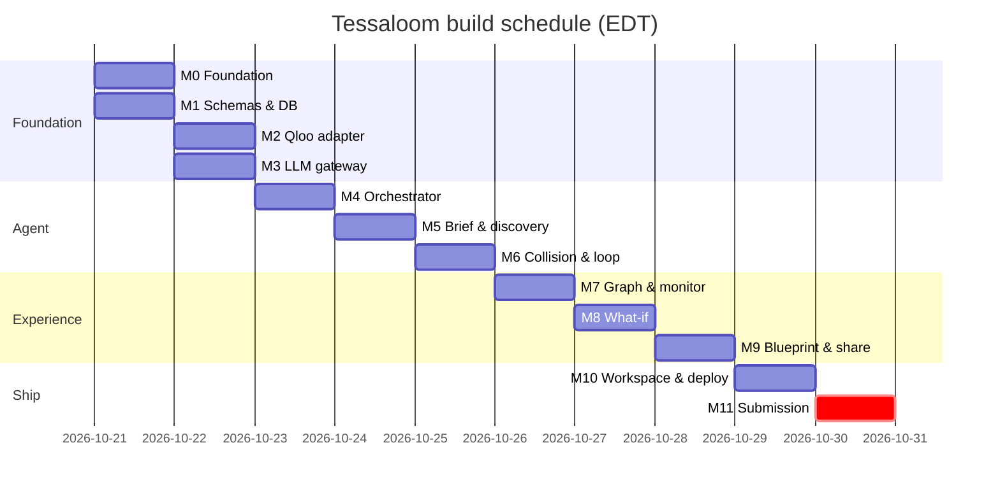

# Tessaloom — Implementation Plan (Codex-Executable Milestones)

> **Status:** v1.1 · 2026-10-20 (review: single-service deployment ADR-017, LLM fallback ADR-018, verified rules, design emphasis)
> **Deadline:** **Friday 2026-10-30, 23:45 EDT** (= 2026-10-31 03:45 UTC). **Internal code freeze: 2026-10-30 18:00 EDT. Target submission: 2026-10-30 21:00 EDT** (a 2 h 45 min buffer).
> **Capacity:** one developer, about 10 working days (Oct 21–30), assisted by Claude Code and OpenAI Codex.
> **Related:** every document in `docs/`. Acceptance criteria refer to [TEST_PLAN.md](TEST_PLAN.md).

---

## 1. How to use this plan (for Codex and Claude Code)

Each milestone is a **self-contained, independently verifiable** engineering task:

- **Objective:** what exists when it is done.
- **Inputs:** the documents and sections to read first. These are the source of truth.
- **Scope:** files and packages to create or change.
- **Out of scope:** explicitly excluded work.
- **Acceptance:** commands that must pass, plus observable checks.
- **Evidence:** what to paste into the PR description (command output, screenshots).

**Global rules for every milestone:**

1. All code, comments, identifiers, commit messages, and task text are in **English**.
2. **Never commit secrets.** Never add `QLOO_API_KEY` or LLM keys to any file. Use `.env.example` placeholders only.
3. **Never** use fixture data as a fallback for live failures. **Never** label fixture data as Qloo data.
4. **Never invent Qloo endpoints, tool names, parameters, or fields.** Use only those in [API_CONTRACTS.md](API_CONTRACTS.md). Anything 🟡 must be read from live `listTools()` output or recorded envelopes, and must be optional in the types.
5. Respect module boundaries ([ARCHITECTURE.md §3.2](ARCHITECTURE.md#32-module-responsibilities)). `apps/web` must not import `qloo-adapter` or `llm-gateway`.
6. **One milestone = one branch = one PR**, with green CI before merging. Do not push to `main` directly. Do not push at all without the owner's authorization.
7. Do not mark a milestone done without the acceptance evidence.
8. Keep changes minimal and idiomatic. Strict TypeScript; no `any` without a justification comment.

---

## 2. Milestone overview and calendar

| Day | Date (EDT) | Milestone(s) | Exit criterion |
|---|---|---|---|
| D1 | Wed Oct 21 | **M0** Foundation · **M1** Domain schemas & database | CI green; migrations apply; core schemas tested |
| D2 | Thu Oct 22 | **M2** Qloo adapter · **M3** LLM gateway | Fixture contract suite green; scripted LLM gateway green |
| ASAP | When the key arrives | **V1** Live Qloo validation spike | LC-0…LC-12 recorded; normalizers updated; DECISIONS updated |
| D3 | Fri Oct 23 | **M4** Orchestrator core + worker + SSE | A full scripted EXPLORATION run in integration tests |
| D4 | Sat Oct 24 | **M5** Brief, intent, resolution, discovery + pages | E2E-02/03/04 green |
| D5 | Sun Oct 25 | **M6** Collision Engine + Hypothesis Loop + Hypothesis Lab | E2E-05/06 green; HL-A1…A5 |
| D6 | Mon Oct 26 | **M7** Evidence Graph + Activity Monitor UI | EG-A1…A4, AM-A1…A4 |
| D7 | Tue Oct 27 | **M8** What-if Simulator + comparisons | E2E-07/08; WI-A1…A5 |
| D8 | Wed Oct 28 | **M9** Blueprint Composer + revisions + export + share | E2E-09/10; EB-A1…A4; PW-A3 |
| D9 | Thu Oct 29 | **M10** Workspace/dashboard/history, samples, deployment, hardening | Deployed; smoke tests green; sample projects in REPLAY |
| D10 | Fri Oct 30 | **M11** Submission package | Video, Devpost text, repo public, final smoke; submitted by 21:00 EDT |

**Critical path:** M0 → M1 → M2/M3 → M4 → M5 → M6 → M8 → M10 → M11. M7 and M9 can be partly parallelized by an assistant once M6's read models exist.

**Live-key dependency.** V1 can be inserted on any day. If the key has not arrived by **D6 (Oct 26)**, follow the contingency in §5.

---

## 3. Milestones

### M0 — Foundation scaffold (D1)

- **Objective:** a buildable, testable, deployable monorepo skeleton with CI and no business logic.
- **Inputs:** ARCHITECTURE §3, §5, §6.1, §11, §12; SECURITY §3, §7; TEST_PLAN §2, §14.
- **Scope:**
  - pnpm workspace: `apps/web` (Next.js App Router, TypeScript strict, Tailwind, shadcn/ui init, `output: "standalone"`), `apps/worker` (Node 22 entry with graceful shutdown), `packages/{core,db,qloo-adapter,llm-gateway,agent,config}` with an `index.ts` stub each.
  - `.nvmrc` = `22.19.0` (or newer 22.x); `engines.node >=22.19.0`; `packageManager` pinned.
  - Shared ESLint (including `no-restricted-imports` for module boundaries), Prettier, Vitest presets, tsconfig base.
  - `packages/config/env.ts`: Zod env schemas for web and worker. The web schema rejects `QLOO_API_KEY` and `*_API_KEY`. Production + `QLOO_MODE=fixture` is rejected.
  - `GET /api/health` route and `GET /api/health/ready`. In M0, `ready` checks DB connectivity only. The worker-heartbeat condition is added in M4, once `worker_heartbeats` exists (M1) and the real worker loop runs.
  - `scripts/start.mjs` (**supervisor**, ADR-017; Node built-ins only):
    - `TL_ROLE=all|web|worker`;
    - `buildChildEnv(role, env)` with the allowlists from ADR-017;
    - spawns web and worker; restart backoff (1 s → 30 s); exit 1 after more than 5 crashes in 5 minutes;
    - SIGTERM/SIGINT forwarding with a 25 s grace period;
    - logs variable **names** only;
    - optional `uid`/`gid` per child when running as root (`TL_WEB_UID` / `TL_WORKER_UID`).
  - `docker-compose.yml` with `postgres:16` (plus an optional `app` service running the image with `TL_ROLE=all`).
  - `Dockerfile`: multi-stage; `node:22-bookworm-slim` (≥ 22.19); `tini`; `npm install --global @qloo/qloo-harness@0.1.26`; users `tl-web` and `tl-worker`; `QLOO_HOME=/home/tl-worker/.qloo` (mode 0700, owned by `tl-worker`); `ENTRYPOINT ["tini","--"]`, `CMD ["node","scripts/start.mjs"]`.
  - `.env.example` (placeholders only), including `LLM_MODEL=claude-opus-5-5` and `LLM_FALLBACK_MODEL=claude-sonnet-5-5`.
  - GitHub Actions `ci.yml`: lint, typecheck, unit, integration with a Postgres service, security (gitleaks + `pnpm audit`), and docker build + **container smoke** (TEST_PLAN §14). Playwright is installed with one smoke spec hitting `/api/health`.
- **Out of scope:** DB schema, any Qloo or LLM calls, any UI beyond a placeholder page.
- **Acceptance:**
  - `pnpm install --frozen-lockfile && pnpm lint && pnpm typecheck && pnpm test` pass.
  - `docker build .` succeeds, and `docker run --rm  qloo --version` prints `0.1.26` or newer. **This runs the official harness binary inside the image only; no credential.**
  - `pnpm --filter web build && node apps/web/.next/standalone/...` serves `/api/health` → 200.
  - The env unit tests prove the deny-list and the production fixture guard.
  - The supervisor unit tests (`buildChildEnv` allowlists, restart policy with fake timers, name-only logging) pass.
  - Container smoke: `docker run` with dummy secrets + Postgres → `/api/health/ready` = 200. `/proc/<web-pid>/environ` contains no `QLOO_API_KEY` / `ANTHROPIC_API_KEY`. Killing the worker causes a supervisor restart.
  - CI is green on the PR.
- **Evidence:** CI run link; the `qloo --version` output; the container-smoke log (variable names only); a screenshot of the placeholder page.

### M1 — Domain schemas and database (D1)

- **Objective:** shared domain contracts and a migrated database with repositories.
- **Inputs:** DATABASE_SCHEMA (all); AGENT_WORKFLOW §4, §14, §18; API_CONTRACTS §3, §4, §9.
- **Scope:**
  - `packages/core`: Zod schemas and enums (provenance, data origin, run state, run kind, hypothesis status, claim test kinds, stances, `BriefInput`, `IntentFrame`, `HypothesisDraft`, `EvidencePlan`, `CritiqueReport`, `BlueprintDraft`, `VariableDelta`, API request/response schemas). UUIDv7 generator; JCS canonicalization; `experimentKey()` and `requestHash()`.
  - `packages/db`: a Drizzle schema for all tables in DATABASE_SCHEMA §4, enums, indexes, CHECK constraints; the fixture-coupling trigger; migrations; repositories for projects, briefs, experiments, runs, events, invocations, snapshots, hypotheses, claims, evidence, comparisons, blueprints, share links, usage counters; transaction helper `withTx`.
  - DB roles SQL script (migrator/app) documented for the managed provider.
- **Out of scope:** business logic, UI.
- **Acceptance:**
  - Migrations apply to an empty DB in CI; `drizzle-kit check` is clean.
  - Unit tests: key/hash golden vectors; schema round trips (TEST_PLAN §3, §6).
  - Integration tests: the evidence CHECK constraints (TEST_PLAN §7.1 rows 2–3); brief versioning concurrency; experiment key uniqueness → `ON CONFLICT` returns the existing row.
- **Evidence:** test output; an ER diagram generated or verified against DATABASE_SCHEMA §3.

### M2 — Qloo adapter (D2)

- **Objective:** a `QlooPort` with harness MCP, harness CLI, and fixture transports, plus envelope mapping, caching, rate limiting, quota guard, and provenance.
- **Inputs:** API_CONTRACTS §5, §6; AGENT_WORKFLOW §10; SECURITY §3.2, §8; TEST_PLAN §5.1.
- **Scope:**
  - `HarnessMcpTransport`: MCP SDK client; spawns `qloo mcp` with `env: process.env`; `listTools()` logged and cached; `qloo_capabilities` readiness; restart with backoff; `AbortSignal` per call; 30 s timeout.
  - `HarnessCliTransport`: `execFile` without a shell; allowlisted commands (`exec <workflow> --input-file`, `api search … --json`); temp file cleanup.
  - `FixtureTransport` with the production guard; a fixture file format with the `_fixture` header; synthetic fixtures for the S1–S3 flows (fictional entity names).
  - Envelope → `QlooOutcome` mapping; permissive normalizers (opaque items + `missingFields`).
  - The snapshot cache (TTL per workflow); the in-flight dedup; the token bucket; the quota guard via `usage_counters`.
  - Every call writes `tool_invocations` (+ a snapshot).
  - A worker boot readiness check → `worker_heartbeats.qloo_ready`.
- **Out of scope:** evaluators; any guessed field mappings beyond the confirmed envelope.
- **Acceptance:** the TEST_PLAN §5.1 suite is green; the fixture-firewall tests are green; lint proves no import from live transports to fixtures.
- **Evidence:** test output; a log excerpt of a fixture run showing provenance fields.

### V1 — Live Qloo validation spike (as soon as the key arrives; about 2–3 hours)

- **Objective:** replace assumptions with recorded facts.
- **Inputs:** TEST_PLAN §5.2; API_CONTRACTS §5.3.
- **Scope:**
  - The owner configures the key locally (`qloo setup --qloo` or a shell export). It is never written to the repository.
  - Run LC-0…LC-12 (≤ 25 calls). Save the redacted tool schemas to `docs/research/qloo-tools.json` and the recorded envelopes to `fixtures/qloo-recorded/` (with `REPLAY` metadata). Committing these is an owner decision pending R-08.
  - Update the normalizers to confirmed fields; update the 🟡 statuses in API_CONTRACTS to ✅ or ⛔ with the date; calibrate the `AUDIENCE_BRIDGE` and `MOMENTUM` evaluators; record a decision in DECISIONS.md.
  - Determine the exact type tokens (`urn:entity:*` vs short names) and the rate-limit error code.
- **Acceptance:** the TEST_PLAN §15 log has LC rows with real results; the API_CONTRACTS capability table is updated; no secrets in the diff (gitleaks).
- **Evidence:** a redacted transcript; a diff of the doc status updates.

### M3 — LLM gateway (D2)

- **Objective:** structured, validated, budgeted LLM calls behind `LlmPort`.
- **Inputs:** API_CONTRACTS §7; ARCHITECTURE §8; AGENT_WORKFLOW §10, §13; SECURITY §6.
- **Scope:**
  - `AnthropicProvider` using `@anthropic-ai/sdk`: `messages.parse` with Zod-derived structured output (`output_config.format`); adaptive thinking with display omitted; `effort` per role; streaming for large outputs; the refusal fallback beta; `stop_reason` checks; prompt caching breakpoint after the stable system prompt. Verify the exact SDK call shapes against the official SDK documentation at implementation time. Do not guess.
  - `ScriptedLlmProvider` for tests (deterministic, supports invalid outputs).
  - Prompt registry (`packages/llm-gateway/prompts/<role>/<id>@<version>.md`) with content hashes; data-block wrapping of untrusted input.
  - The repair loop (max 1); cost estimation from usage and a price table in config; `llm_invocations` persistence.
  - Validators from AGENT_WORKFLOW §13.2 (in `packages/agent`, called by the gateway).
  - The **fallback model** (`LLM_FALLBACK_MODEL`, default `claude-sonnet-5-5`) is applied per whole step on unavailability, cost pressure, or `LLM_MODE=economy`; `fallback_used` is recorded (ADR-018). Price table in config (ADR-018 values, with the source date).
- **Acceptance:** unit tests for the repair flow, refusal, truncation, the fallback switch, cost estimation, and each validator. **Owner-run live checks LM-1…LM-3** (TEST_PLAN §5.3) confirm that the account can access both models. They are logged in TEST_PLAN §15 and not required for CI. The owner provides a funded Claude Console API key; Claude Code or Codex subscriptions do not provide it.
- **Evidence:** test output.

### M4 — Orchestrator core, worker, SSE (D3)

- **Objective:** a durable state machine executing runs step by step, with events streamed to the browser.
- **Inputs:** AGENT_WORKFLOW §4–§11, §17; API_CONTRACTS §4.3, §8, §10; DATABASE_SCHEMA §6.
- **Scope:**
  - Transition table + guards (`packages/agent/machine.ts`); the run-step handler loop; pg-boss queues; idempotent commits with `state_version`; budget guard; cancellation; paused-run expiry; the worker heartbeat.
  - Stub handlers for all states that use `ScriptedLlmProvider` and `FixtureTransport` (later milestones replace the stubs with real role logic).
  - Web: `POST /projects/:id/experiments`, `GET /runs/:id`, `GET /runs/:id/events` (SSE with `Last-Event-ID`), `POST /runs/:id/{confirmations,cancel,retry}`; the workspace cookie middleware, CSRF, and rate limiting.
  - Extend `/api/health/ready` with the worker-heartbeat condition (< 30 s), as specified in API_CONTRACTS §4.8.
- **Acceptance:** TEST_PLAN §4 items 1–11 green; an SSE reconnect test green; the stale-heartbeat test (TEST_PLAN §8) green.
- **Evidence:** test output; a short screen capture of raw SSE events in the browser.

### M5 — Brief, intent, resolution, discovery (D4)

- **Objective:** a real R1 and R2 and the first two product pages.
- **Inputs:** PRD §6.1; UI_UX_SPEC §4.2, §4.3; AGENT_WORKFLOW §2, §8, §11 (H1, H2), §16 step 1.
- **Scope:**
  - R1 prompt and handler; gate H1; R2 resolution (search/find tags/describe) with the exact-single auto-accept rule; gate H2; discovery threads via `recommend`; tags via `entityTags` when available; `entity_relations` (THREAD, HAS_TAG).
  - Pages: Creative Brief (form, preview, H1 panel, versions); Discovery Canvas (H2 panel, React Flow lanes, inspector, list view). The tension slider UI is wired in M6.
  - The design tokens and the provenance chip components from UI_UX_SPEC §2.
- **Acceptance:** E2E-02, E2E-03, E2E-04 (without the tension assertions); CI-A1…A4.
- **Evidence:** screenshots of the brief, H2, and canvas pages in fixture mode, with the FIXTURE banner visible.

### M6 — Collision Engine and Creative Hypothesis Loop (D5)

- **Objective:** evidence-graded hypotheses.
- **Inputs:** AGENT_WORKFLOW §8.2, §12, §13, §16; PRD §6.2, §6.3; UI_UX_SPEC §4.4.
- **Scope:**
  - The collision pool (bridges, scores, tension, MMR); the tension slider (client-side preview from stored scores; commit continues the run).
  - R3 generation and revision; R4 planning (allowlist + budget trimming); evidence collection; deterministic evaluators for all test kinds (fields 🟡 → INSUFFICIENT/`FIELD_UNAVAILABLE` until V1); R4 critique; status and score computation; termination rules; gate H3.
  - The Hypothesis Lab page: cards, status grouping, evidence drawer, trace dialog, score breakdown, weights control (rescore-only branch creation calls M8's API; until M8 exists, the control is disabled with an explanation, which counts as a known gap for exactly one day).
- **Acceptance:** E2E-05, E2E-06; CC-A1…A4; HL-A1…A5; TEST_PLAN §7.1 pointer verification.
- **Evidence:** test output; screenshots.

### M7 — Evidence Graph and Activity Monitor (D6)

- **Objective:** a full graph experience and the activity dock.
- **Inputs:** UI_UX_SPEC §4.3, §4.4 (graph tab), §5, §8; PRD §6.4, §6.7.
- **Scope:** the graph projection (`core/graph`) and the `/experiments/:id/graph` endpoint; React Flow custom node and edge types per provenance; filters; keyboard navigation; the list view; the layout save. The activity dock: run header, gate card, budget meters (Recharts or plain bars), the virtualized timeline, tool and validation detail expansions, the full view with a state-duration chart.
- **Acceptance:** EG-A1…A4; AM-A1…A4; A11Y-01 for the discovery and hypotheses pages.
- **Evidence:** screenshots; the axe report.

### M8 — What-if Experimentation Simulator (D7)

- **Objective:** genuine counterfactual branches and comparisons.
- **Inputs:** AGENT_WORKFLOW §15; API_CONTRACTS §4.5, §4.7; UI_UX_SPEC §4.5.
- **Scope:** the delta planner (`dependsOn` + `requestHash` diff); branch creation with the deterministic key; gate H4; the COUNTERFACTUAL run kind (hold-fixed; regenerate is stretch); the comparison metrics; R5 narrative with placeholders and numeric fidelity; ad hoc resolution (`/resolve`); the What-if Lab page (variable editor, preview, comparison header, hypothesis delta table, per-query diff, slope and stance charts with table toggles, branch tree); REVALIDATION.
- **Acceptance:** E2E-07, E2E-08; WI-A1…A5; TEST_PLAN §7.2.
- **Evidence:** test output; screenshots of the comparison view.

### M9 — Experience Blueprint Composer and sharing (D8)

- **Objective:** traceable blueprints, revisions, exports, and share links.
- **Inputs:** PRD §6.6, §6.8; UI_UX_SPEC §4.6, §4.8; API_CONTRACTS §4.6; SECURITY §4.3.
- **Scope:** R6 composition + the traceability validator (max 1 repair); optional gap-fill queries (≤ 4); blueprint pages (sections, blocks, citations, constraints, traceability meter, revisions, edit-in-place); Markdown and JSON export; the print stylesheet; share links (create/list/revoke; token shown once); the `/share/[token]` page with noindex and no-referrer.
- **Acceptance:** E2E-09, E2E-10; EB-A1…A4; PW-A3; the share security tests in TEST_PLAN §9.
- **Evidence:** an exported Markdown sample (fixture-labeled); screenshots.

### M10 — Workspace, samples, deployment, hardening (D9)

- **Objective:** a public, reliable, judge-ready deployment.
- **Inputs:** PRD §6.8; UI_UX_SPEC §4.1, §4.7, §6, §7; ARCHITECTURE §11; SECURITY (all); TEST_PLAN §9, §13.
- **Scope:**
  - The Home Dashboard (hero, samples, projects, active runs, system status); Project History (timeline, tree, compare, run replay, exports, share management); the coach-mark onboarding tour; all empty, error, and recovery states.
  - **Sample projects:** run S1–S3 **live** (once the key is available), pin their snapshots, and seed them into the `system` workspace in REPLAY mode (subject to R-08; see the §5 contingency).
  - Deploy: the managed Postgres (with roles); **one** always-on service from the image (`TL_ROLE=all`, exactly 1 instance, about 2 GB RAM to start); one secret set; the release / pre-deploy migration with the migrator URL; the platform health check on `/api/health/ready`; scale-to-zero disabled through **Nov 16** (+ buffer to Nov 30); TLS; the custom domain optional.
  - Hardening: UID separation for web and worker if the platform permits a root start (ADR-017; otherwise record the residual risk); per-child heap limits; security headers and CSP; rate limits; quota guard values set from the published quota; a Console spend limit for the LLM key (ADR-018); retention jobs; the log redaction review.
  - **Design polish pass** on the Dashboard, Hypothesis Lab, What-if Lab, and Blueprint pages ("Design" is 25% of judging).
- **Acceptance:** TEST_PLAN §13 smoke tests pass on the public URL; A11Y-01…04 pass; E2E-12, E2E-13 pass; gitleaks over the full history passes.
- **Evidence:** the public URL; the smoke test output; the Lighthouse accessibility score (informational).

### M11 — Submission package (D10)

- **Objective:** a compliant, compelling submission before the deadline.
- **Inputs:** HACKATHON_CHECKLIST (all); kit `docs/SUBMISSION.md`.
- **Scope:**
  - The README completed: problem statement; the Qloo workflows used and why; a redacted request-to-result walkthrough; setup from a clean environment (fixture mode and live mode); known limitations; license; the architecture links.
  - Screenshots (required by our plan). A demo video is **optional**: the official rules do not make it mandatory (externally verified). It is recommended (≤ 3 minutes, REPLAY mode, SECURITY §10 hygiene) only if time allows after the smoke tests pass.
  - The Devpost text in English, structured around the four judging criteria (HACKATHON_CHECKLIST §2.7).
  - Make the repository public (owner action) after the full-history gitleaks scan.
  - The final smoke test; then submit. Keep the deployment always-on through judging.
- **Acceptance:** every "must" item in HACKATHON_CHECKLIST is checked with evidence; submitted by **21:00 EDT**.
- **Evidence:** the Devpost submission confirmation (screenshot); the public repository URL; the demo URL.

---

## 4. Scope protection policy (no silent elimination)

All eight modules ship. If the schedule slips, **depth** is reduced in this order. Each reduction must be recorded in DECISIONS.md and listed under "Known limitations" in the README.

1. Stretch (S) requirements in the PRD are deferred first: regenerate mode, ad hoc any-two comparison, section recompose, lineage view, layout persistence, admin view.
2. The location, time-window, and audience-band variables in the What-if Lab are disabled with an explanation, if they are unconfirmed live.
3. Test kinds whose Qloo capability is unavailable live become UNTESTABLE or INSUFFICIENT with an explanation. **This is not a mock.**
4. The Graph overlay of branches falls back to the side-by-side comparison only.
5. The visual polish of non-core pages (History) is reduced; function is kept.

**Never acceptable:** replacing a module with a static mockup; presenting fixture data in production; skipping the provenance labeling; skipping security controls on secrets; dropping the design polish of the core pages ("Design" is one of four equally weighted judging criteria).

---

## 5. Contingencies

| Trigger | Response |
|---|---|
| The Qloo key has not arrived by **Oct 26** | Continue on fixtures. Escalate through the kit Q&A discussions (no secrets) and email the organizer contact listed in the kit for private matters. Prepare V1 scripts so that validation takes < 2 hours once the key arrives. The hosted demo shows sample projects only after live recordings exist; **until then, the public demo must clearly state that live Qloo access is pending, and fixture mode must never be deployed as production.** |
| The key arrives but a capability differs from plan | Update the adapter and evaluators; mark the test kind accordingly; record it in DECISIONS.md |
| Storing Qloo responses is not permitted (R-08) | Sample projects run **live** on demand within the quota guard (with smaller budgets). Drop the snapshot persistence beyond the short-term cache, and keep only the evidence facts needed for traceability if allowed; otherwise show the traceability links for the session only. |
| The LLM budget is constrained | Lower the per-run budgets and the generation count; the owner may choose a lower-cost model tier via `LLM_MODEL` (recorded in the experiment key) |
| A hosting issue on deploy day | Keep a pre-tested alternative: the same Docker image as a single Docker web service on Render, prepared on D9 |
| A milestone overruns by more than half a day | Apply the §4 depth reductions to that milestone; do not borrow from M10/M11 |

---

## 6. Recommended first milestone for Codex

**Start with M0 (Foundation scaffold), followed immediately by M1.** M0 de-risks the hardest platform constraint early: Node ≥ 22.19 plus the official harness in a non-serverless, single-service container with a supervisor and per-process env isolation. It also sets up CI guardrails (gitleaks, env deny-list, module boundaries, container smoke) before any feature code exists. Codex prompt template:

> Implement milestone **M0 — Foundation scaffold** exactly as specified in `docs/IMPLEMENTATION_PLAN.md §3 (M0)`. Read `docs/ARCHITECTURE.md` §3, §5, §6.1, §11, §12, `docs/DECISIONS.md` ADR-017, `docs/SECURITY.md` §3 and §7, and `docs/TEST_PLAN.md` §2, §9, and §14 first. Follow the global rules in §1. Do not implement any business logic, Qloo calls, or LLM calls. Do not add secrets. Work on branch `m0-foundation`, open a PR, and include the acceptance evidence listed for M0. Do not push to `main`.
