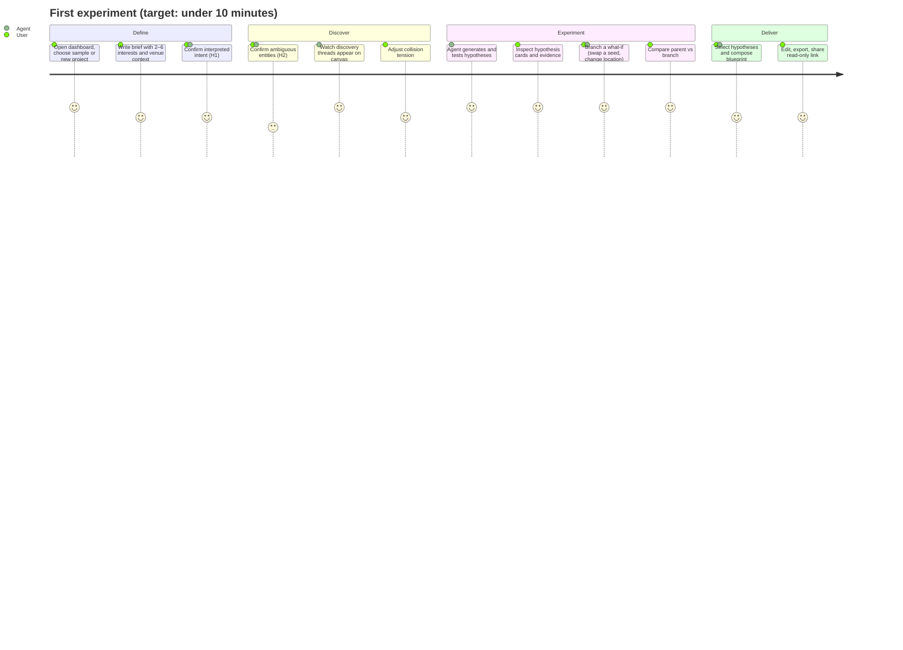

# Tessaloom — Product Requirements Document

> **Product:** Tessaloom, an agentic cultural experimentation studio
> **Tagline:** *Where Different Worlds Create New Possibilities.*
> **Event:** Qloo Agentic Hackathon 2026 · submission deadline **Friday, October 30, 2026, 11:45 PM EDT**
> **Status:** Requirements baseline v1.1 · 2026-10-20 (review: verified rules, judging criteria alignment, LLM budget) · owner: LZH-1-G (solo developer)
> **Related:** [ARCHITECTURE.md](ARCHITECTURE.md) · [UI_UX_SPEC.md](UI_UX_SPEC.md) · [AGENT_WORKFLOW.md](AGENT_WORKFLOW.md) · [TEST_PLAN.md](TEST_PLAN.md) · [IMPLEMENTATION_PLAN.md](IMPLEMENTATION_PLAN.md)

---

## 1. Problem

Independent bookstores, cafés, small venues, and community organizers compete for attention with programming such as readings, listening nights, themed pop-ups, and workshops. Their ideas usually come from intuition or copying what others do. They have no affordable way to:

- explore what could happen when **different cultural worlds meet** (a novelist and a music genre, a film aesthetic and a cuisine);
- tell **which combinations have real audience affinity** behind them and which are just appealing guesses;
- **test "what if" alternatives** (a different author, another neighborhood, a different audience age band) before committing money and time;
- turn an idea into an **actionable plan** that honestly states what is known and what is speculative.

Recommendation engines answer "what will this person like?" They do not answer "what *new* cultural experience could work for this community, and why should I believe it?"

## 2. Product vision

Tessaloom is a **studio for cultural experiments**. Users bring a creative challenge that involves several cultural interests. An agent:

1. discovers relationships across cultural domains with Qloo's cultural intelligence;
2. weaves **collision hypotheses** (original combinations);
3. **tests them against evidence**;
4. lets users run **counterfactual experiments** that genuinely recompute evidence;
5. composes an **experience blueprint** where every statement is either traceable to evidence or clearly labeled as speculation.

**Differentiator in one sentence:** Tessaloom treats creative ideas as *hypotheses* that are tested, compared, and branched with real cultural data. It is not a recommendation list with a chat window on top.

## 3. Target users

| Persona | Context | Primary job-to-be-done | Success for them |
|---|---|---|---|
| **P1 — Indie bookstore events lead** ("Maya") | 2–4 staff, monthly events, tight budget | "Design a reading night that draws people who don't usually come to bookstores." | One concept with evidence they can pitch to staff and partners in under 20 minutes |
| **P2 — Café owner** ("Tomás") | Neighborhood café wanting weekday evening traffic | "Find a themed night that fits my neighborhood and my regulars' tastes." | A concept that is plausible for their locality, with logistics and constraints listed |
| **P3 — Community event organizer** ("Aisha") | Library or community-center programs, grant-funded | "Create a festival segment that bridges two communities' cultural interests." | A comparison of alternatives with a defensible rationale for funders |
| **P4 — Hackathon judge** (secondary, critical) | Has limited minutes per project | "Understand the unique value fast and verify the Qloo integration is meaningful." | Understands the hypothesis→evidence→counterfactual loop within 3 minutes, with no sign-up |

## 4. Goals and non-goals

### 4.1 Goals

- **G1.** Turn a multi-interest creative brief into ranked, evidence-graded collision hypotheses.
- **G2.** Make the provenance of every displayed fact unmistakable: Qloo-sourced, app-derived, model interpretation, creative speculation, user-provided, or development fixture.
- **G3.** Provide genuine counterfactual experimentation, where results change because the retrieved data changed.
- **G4.** Produce actionable, exportable experience blueprints that trace back to evidence.
- **G5.** Persist, revisit, compare, export, and share experiments.
- **G6.** Be judge-ready: a public hosted demo, sample projects, no sign-up, and reliability during judging.
- **G7.** Use Qloo responsibly: aggregate affinities only, no personal data sent to Qloo, and no causal or individual claims.

### 4.2 Non-goals (for this submission)

- Personal recommendations for individuals, user taste profiles, or social login.
- Ticketing, payments, scheduling, CRM, or email marketing.
- A chat-first interface. Chat is not the primary interaction model.
- Mobile-native apps. The web app is responsive.
- Multi-user real-time collaboration. Sharing is read-only.
- Model fine-tuning or a custom recommendation model.

The domain model is generic (brief → interests → hypotheses → evidence → blueprint). Use cases other than independent venues — for example a brand collaboration studio, a curriculum designer, or a festival programmer — need only a new `use_case` value, a venue/constraint schema extension, and blueprint section templates. **No structural redesign is required** (see [ARCHITECTURE.md §4](ARCHITECTURE.md#4-the-eight-product-modules-mapped-to-the-architecture)).

## 5. Core user journey

## 6. Functional requirements by module

Priority: **R** = required for submission (the acceptance criteria in [TEST_PLAN.md §12](TEST_PLAN.md#12-module-acceptance-criteria) must pass) · **S** = stretch (built if time allows; never replaced by a static mock). All eight modules are in scope for the final product.

### 6.1 Module 1 — Cultural Intelligence

| ID | Requirement | Priority |
|---|---|---|
| CI-1 | Resolve each brief interest to Qloo entity or tag candidates via the Qloo adapter | R |
| CI-2 | Auto-accept only unambiguous exact matches. Otherwise ask the user to pick, refine, or exclude (gate H2). | R |
| CI-3 | Show disambiguating details using only fields Qloo actually returned | R |
| CI-4 | Expand cross-domain "threads": recommendations of other target domains for each seed | R |
| CI-5 | Retrieve tags for discovered entities when available, to power novelty and tag-resonance tests | R (degrades gracefully if the capability is unavailable — 🟡) |
| CI-6 | Record every Qloo call with redacted arguments, status, latency, data origin, and raw snapshot | R |
| CI-7 | Cache responses within TTLs and label cache reuse | R |
| CI-8 | Show Qloo readiness and a "live vs replay vs fixture" mode indicator | R |
| CI-9 | Location-aware insights (where popular) when a venue locality is provided | S (🟡) |
| CI-10 | Trend momentum for discovered entities | S (🟡) |

### 6.2 Module 2 — Cultural Collision Engine

| ID | Requirement | Priority |
|---|---|---|
| CC-1 | Build a collision candidate pool from cross-domain threads and bridges (shared tags, co-occurrence) | R |
| CC-2 | Compute relevance, novelty, and tension-fit for each candidate deterministically, with breakdowns | R |
| CC-3 | Provide a **Collision Tension** control (Harmonious ↔ Unexpected) that changes pool selection | R |
| CC-4 | Select a diverse pool (MMR) so that candidates do not repeat the same domain pairing | R |
| CC-5 | Flag reduced-input novelty when tag data is unavailable | R |
| CC-6 | Let the user pin or exclude specific elements before hypothesis generation | S |

### 6.3 Module 3 — Creative Hypothesis Lab

| ID | Requirement | Priority |
|---|---|---|
| HL-1 | Generate 4–6 hypotheses per iteration from the pool. Each has a title, premise, grounded elements, 1–3 testable claims, and an experience sketch. | R |
| HL-2 | Plan evidence queries for each claim within an allowlist and the remaining budget | R |
| HL-3 | Grade each claim with a deterministic evaluator (SUPPORTS / CONTRADICTS / NEUTRAL / INSUFFICIENT) | R |
| HL-4 | Critique, revise, retire, or spawn hypotheses across up to 3 iterations, with explicit termination | R |
| HL-5 | Show hypothesis status (SPECULATIVE … UNTESTABLE) and composite score with a breakdown | R |
| HL-6 | Let users adjust scoring weights (rescore only, clearly labeled) | R |
| HL-7 | Show hypothesis lineage across revisions | S |
| HL-8 | Let users pin a hypothesis or add notes | S |

### 6.4 Module 4 — Interactive Cultural Evidence Graph

| ID | Requirement | Priority |
|---|---|---|
| EG-1 | Render entities, tags, hypotheses, claims, evidence, and experiments as an interactive graph (pan, zoom, select, filter) | R |
| EG-2 | Visually distinguish provenance classes with shape, border pattern, icon, **and** text label (not color alone) | R |
| EG-3 | Selecting a node opens an inspector with facts, sources, and the request-to-result trace | R |
| EG-4 | Filter by provenance, domain, hypothesis status, and data origin | R |
| EG-5 | Provide an accessible list/table alternative to the graph | R |
| EG-6 | Persist the user's node layout | S |
| EG-7 | Overlay a branch onto its parent to highlight changed edges | S |

### 6.5 Module 5 — What-if Experimentation Simulator

| ID | Requirement | Priority |
|---|---|---|
| WI-1 | Create a branch by changing variables: seeds (add/remove/swap), target domains, location, time window, tension, weights, constraints | R (seeds, domains, weights, constraints) / S (location, time window, audience band — 🟡) |
| WI-2 | Before running, show a preview: dirty queries, reused queries, estimated Qloo calls; confirm when above the threshold | R |
| WI-3 | Re-execute **only** dirty queries live, and re-evaluate every claim | R |
| WI-4 | Compare the parent and branch with overlap@K, RBO, entered/exited entities, stance changes, status changes, and score deltas | R |
| WI-5 | State explicitly when no new Qloo data was retrieved (rescore-only) | R |
| WI-6 | Generate a narrative explanation grounded in the computed metrics, with citations | R |
| WI-7 | Regenerate mode (new hypotheses under changed variables) | S |
| WI-8 | Compare any two experiments in a project (not only parent/child) | S |

### 6.6 Module 6 — Experience Blueprint Composer

| ID | Requirement | Priority |
|---|---|---|
| EB-1 | Compose a blueprint from 1–3 selected hypotheses: concept, audience, programming, atmosphere, partners, promotion, logistics, risks/constraints, and measurement | R |
| EB-2 | Every block carries a provenance label. Evidence-backed blocks cite evidence. Speculative blocks are labeled. | R |
| EB-3 | Show a traceability report (cited / interpretation / speculative counts) and practical constraints with severity | R |
| EB-4 | Let users edit blocks, creating append-only revisions with history | R |
| EB-5 | Export to Markdown (with an evidence appendix) and JSON; print-friendly view for PDF | R |
| EB-6 | Recompose a single section with an instruction | S |

### 6.7 Module 7 — Agent Activity Monitor

| ID | Requirement | Priority |
|---|---|---|
| AM-1 | Live timeline of run events over SSE: states, decision summaries, tool calls, validation results | R |
| AM-2 | Budget meters (Qloo calls, LLM calls/tokens, time), live | R |
| AM-3 | Controls: cancel, answer confirmations, retry a failed transient step | R |
| AM-4 | Never display private chain-of-thought; only decision summaries | R |
| AM-5 | Show tool call details on expand: redacted arguments, status, result count, latency, origin | R |
| AM-6 | Persist and replay the activity of past runs | R |

### 6.8 Module 8 — Persistent Project Workspace

| ID | Requirement | Priority |
|---|---|---|
| PW-1 | An anonymous workspace via cookie. No sign-up and no personal data. | R |
| PW-2 | Dashboard listing projects, recent experiments, and sample projects | R |
| PW-3 | Project history: brief versions, the experiment tree (root and branches), runs, blueprints | R |
| PW-4 | Revisit any experiment read-only with its full evidence | R |
| PW-5 | Fork sample projects (replay data) | R |
| PW-6 | Read-only share links with expiry and revocation | R |
| PW-7 | Export the full project bundle as JSON | R |
| PW-8 | Archive projects | S |

## 7. Non-functional requirements

| ID | Category | Requirement |
|---|---|---|
| NFR-1 | Performance | Page TTFB < 800 ms p75 on the hosted demo. Graph interaction at ≥ 30 fps with ≤ 300 nodes. |
| NFR-2 | Agent latency | An EXPLORATION run reaches `AWAITING_HYPOTHESIS_SELECTION` in ≤ 7 minutes p90 (wall-clock budget 420 s). First visible activity within 3 s of starting. |
| NFR-3 | Reliability | No data loss on a worker restart. Runs resume or fail cleanly. The hosted demo is available ≥ 99% during judging, with sample projects available even if Qloo or the LLM provider is down. |
| NFR-4 | Honesty | No fixture data in production. No silent mock substitution. Every fact is provenance-labeled. |
| NFR-5 | Security | Secrets only in worker env. OWASP ASVS L1 baseline. See [SECURITY.md](SECURITY.md). |
| NFR-6 | Privacy | No personal data collected. No personal data sent to Qloo. |
| NFR-7 | Accessibility | WCAG 2.2 AA. Keyboard-operable. Screen-reader alternatives for the graph and charts. |
| NFR-8 | Cost | Global daily caps on LLM spend and Qloo calls, with configurable defaults. |
| NFR-9 | Reproducibility | Deterministic experiment keys. Exact replay from stored snapshots and outputs. |
| NFR-10 | Maintainability | Strict TypeScript, module boundaries enforced by lint, ≥ 80% line coverage in `core` and `agent`. |

## 8. Success metrics

Measured on the hosted demo, plus a scripted evaluation of the three scenarios in [TEST_PLAN.md §11](TEST_PLAN.md#11-representative-scenarios).

| Metric | Target |
|---|---|
| Time from landing to first hypothesis cards (sample project) | ≤ 60 s |
| Time from new brief to evidence-graded hypotheses (live) | ≤ 7 min p90 |
| Share of displayed facts with a provenance label | 100% |
| Share of SUPPORTED/CONTRADICTED hypotheses whose evidence links resolve to stored tool invocations | 100% |
| Counterfactual branches that report dirty/reused query counts | 100% |
| Blueprint blocks citing evidence or labeled speculative | 100% |
| Judge comprehension (informal test with 2–3 people): can explain the hypothesis→evidence→what-if loop after 3 minutes | ≥ 2 of 3 |

**Alignment with the official judging criteria** (four, equally weighted; externally verified):

| Criterion | Product goals that serve it |
|---|---|
| Technological Implementation | G1, G3, G5; NFR-2, NFR-3, NFR-9 |
| Design | G2, G6; NFR-1, NFR-7; UI_UX_SPEC |
| Potential Impact | G4, G5; personas P1–P3 |
| Quality of the Idea | G1, G3; ORIGINALITY_STRATEGY |

## 9. Representative scenarios

The full test specifications are in [TEST_PLAN.md §11](TEST_PLAN.md#11-representative-scenarios). **Entity names are user inputs; whether Qloo resolves them, and what it returns, is unknown until live execution.**

1. **"Midnight Margins" — an independent bookstore.** Interests: a contemporary Japanese novelist, city-pop music, Nordic noir TV. Venue: a 60-capacity bookstore. What-if: swap Nordic noir for a cozy-mystery tag.
2. **"Low-Fi Lounge" — a neighborhood café.** Interests: cumbia, cozy video games, specialty coffee culture. Venue: a 35-seat café with weekday evenings. What-if: change the target domain from podcasts to TV shows; raise collision tension.
3. **"Future Roots" — a community library festival.** Interests: an Afrofuturist novelist, an experimental jazz artist, community board games. Venue: library hall, capacity 120. What-if: swap the jazz artist for a contemporary R&B artist; change the time window for momentum.

## 10. Constraints and dependencies

| Item | Detail |
|---|---|
| Deadline | **2026-10-30 23:45 EDT.** About 10 working days remain as of 2026-10-20. Internal freeze: **2026-10-30 18:00 EDT.** |
| Team | One developer plus AI coding assistants (Claude Code, Codex). Their subscriptions do **not** cover runtime LLM API use. |
| Qloo credential | **Requested, not yet received.** All live integration work is blocked until it arrives. Development proceeds on labeled fixtures. |
| Qloo surfaces | Harness only (`qloo mcp` / `exec` / `api`). Serverless is not supported. |
| LLM | Runtime API key with billing required (default provider: Anthropic). |
| Hosting | One always-on container service (web + worker under a supervisor, ADR-017) plus managed PostgreSQL |
| Rules (externally verified by the owner against the official Devpost rules) | Individual participation allowed. A working app with meaningful Qloo API integration, a public demo link, a public open-source repository with a detectable license, and an English description are required. A video is not mandatory. Judging runs **Nov 2–16, 2026**. There are four equally weighted criteria: **Technological Implementation, Design, Potential Impact, Quality of the Idea**. See [HACKATHON_CHECKLIST.md](HACKATHON_CHECKLIST.md). |
| LLM runtime budget | Estimated about $1.09 per typical exploration run on `claude-opus-5-5`; a $150 prepaid budget is recommended ([ADR-018](DECISIONS.md#adr-018-llm-model-verification-fallback-model-cost-model-and-credentials)) |

## 11. Release plan (summary)

Milestones M0–M10 are defined in [IMPLEMENTATION_PLAN.md](IMPLEMENTATION_PLAN.md). Every milestone builds toward the final architecture; nothing is a throwaway prototype. A live-validation milestone (V1) runs as soon as the Qloo key arrives, whenever that is.

## 12. Open questions

| # | Question | Owner | Needed by |
|---|---|---|---|
| Q1 | What are the event quota, rate limit, and credential expiry? Is the key valid through judging? | Organizers | Before M8 tuning |
| Q2 | Are recording and replaying Qloo responses for sample projects permitted? | Organizers / Qloo terms | Before seeding samples (M10) |
| Q3 | Exact MCP tool input schemas and result fields | Live validation (V1) | As soon as the key arrives |
| Q4 | Official rules: video requirements, judging criteria, eligibility | **Resolved 2026-10-20** (externally verified by the owner; personal eligibility details remain the owner's to confirm) | — |
| Q5 | Runtime LLM budget the owner is willing to fund (recommendation: $150 prepaid, ADR-018) | Owner | M3 |
